# Sesión 12: Introducción a agentes de IA — 123 min

[Antonio Perez](https://training.lidr.co/members/36030888)

⏳Tiempo estimado: 1 min

[Video](https://player.vimeo.com/video/1200715792?h=d4075ef446)

Tu RAG ya funciona: recupera presupuestos parecidos a lo que buscas. Pero parecido no es lo mismo que útil, y cuando el sistema te devuelve una app de pagos al pedirle una plataforma de e-commerce, estás a un paso de una mala estimación. En esta sesión convertimos una recuperación aceptable en una recuperación precisa y lo demostramos con números, no con sensaciones.

**En esta sesión descubrirás:**

→ Por qué la búsqueda vectorial ordena mal los resultados finos y cómo el reranking con cross-encoders reordena los candidatos leyendo consulta y documento juntos

→ Cómo combinar búsqueda semántica y búsqueda por palabras exactas con full-text search en PostgreSQL, y cómo fusionar ambos rankings con Reciprocal Rank Fusion

→ Cómo medir con un golden set propio si cada técnica compensa su coste en latencia, antes de llevarla a producción

→ Cómo descomponer consultas complejas en sub-búsquedas y dirigir cada una al índice correcto mediante routing

→ Cómo el filtrado por metadatos y el decaimiento temporal evitan que un presupuesto obsoleto contamine tus estimaciones

Al finalizar, recuerda añadir tu opinión sobre el contenido y el ejercicio de este módulo:
🆙Evalúa el contenido y el ejercicio de este Módulo

### 
❗Obtén los recursos👇

- 

[✍️ Ejercicio: Introducción a agentes de IA🔴

- Visibility: Visible
- Unlocking: None
- Completion: Button
- Comments: On
- Thumbnail: Default
](https://training.lidr.co/posts/ai-engineering-202604-✍️-ejercicio-introduccion-a-agentes-de-ia🔴)⏱ La fecha límite es Martes 7 de Julio, al final del día. El sistema de estimación que venimos construyendo funciona...
- 

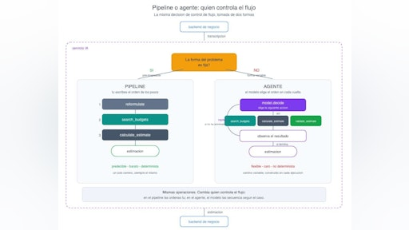

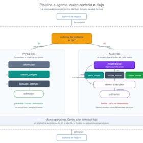

[📄 De pipeline a agente: cuándo tu sistema RAG necesita una capa de decisión 🔴 — 23 min

- Visibility: Visible
- Unlocking: None
- Completion: Button
- Comments: On
- Thumbnail: Default
](https://training.lidr.co/posts/ai-engineering-202604-📄-de-pipeline-a-agente-cuando-tu-sistema-rag-necesita-una-capa-de-decision-🔴-23-min)⏳ Tiempo estimado: 23 min Nuestro sistema de estimación funciona. Le pasas una transcripción de reunión, reformula la...
- 

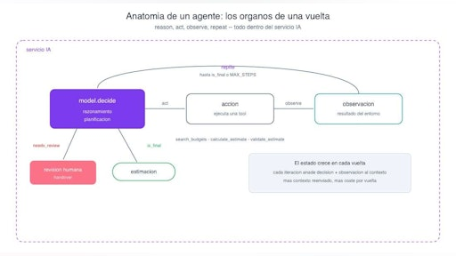

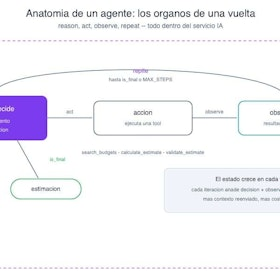

[📄 Anatomía de un agente: qué ocurre dentro del bucle 🔴 — 22 min

- Visibility: Visible
- Unlocking: None
- Completion: Button
- Comments: On
- Thumbnail: Default
](https://training.lidr.co/posts/ai-engineering-202604-📄-anatomia-de-un-agente-que-ocurre-dentro-del-bucle-🔴-22-min)⏳ Tiempo estimado: 22 min Un agente, reducido a su forma más honesta, es un bucle: el modelo decide una acción, tu...
- 

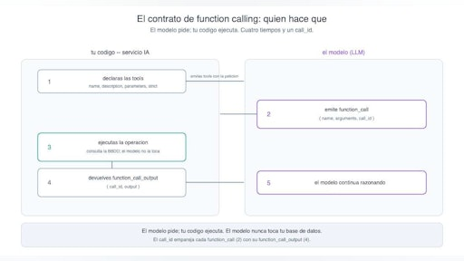

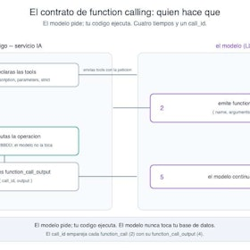

[📄 Function calling en la práctica: tools, schemas y contrato con el modelo🔴 — 21 min

- Visibility: Visible
- Unlocking: None
- Completion: Button
- Comments: On
- Thumbnail: Default
](https://training.lidr.co/posts/ai-engineering-202604-📄-function-calling-en-la-practica-tools-schemas-y-contrato-con-el-modelo🔴-21-min)⏳ Tiempo estimado: 21 min Un agente que solo razona no sirve de mucho. Para estimar un proyecto necesita hacer cosas:...
- 

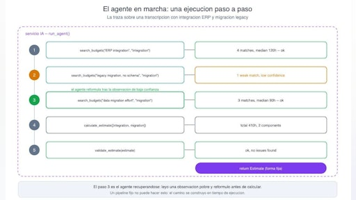

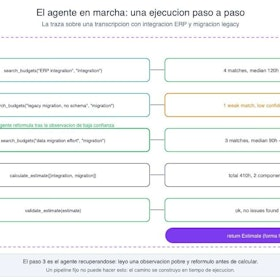

[📄 El bucle agéntico paso a paso🔴 — 18 min

- Visibility: Visible
- Unlocking: None
- Completion: Button
- Comments: On
- Thumbnail: Default
](https://training.lidr.co/posts/ai-engineering-202604-📄-el-bucle-agentico-paso-a-paso🔴-18-min)⏳ Tiempo estimado: 18 min Vamos a construir el agente a mano. Sin LangChain, sin ningún framework de orquestación. No...
- 

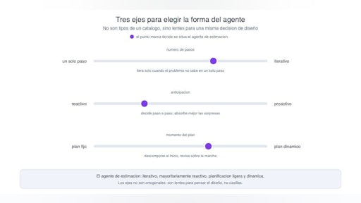

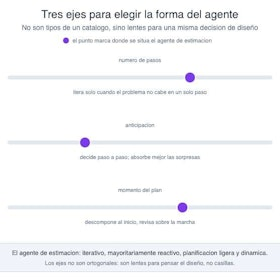

[📄 Patrones de agentes y diseño de tools de calidad 🔴 — 21 min

- Visibility: Visible
- Unlocking: None
- Completion: Button
- Comments: On
- Thumbnail: Default
](https://training.lidr.co/posts/ai-engineering-202604-📄-patrones-de-agentes-y-diseno-de-tools-de-calidad-🔴-21-min)⏳ Tiempo estimado: 21 min "Agente" no es una cosa. Bajo esa palabra caben formas muy distintas de resolver un...
- 

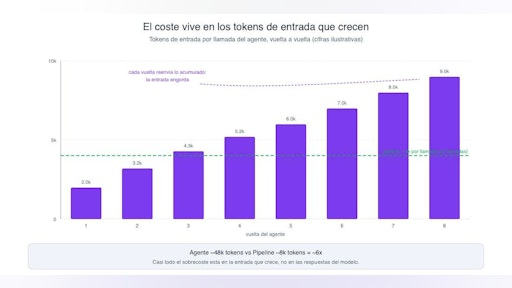

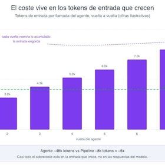

[📄 Cuánto cuesta un agente🔴 — 18 min

- Visibility: Visible
- Unlocking: None
- Completion: Button
- Comments: On
- Thumbnail: Default
](https://training.lidr.co/posts/ai-engineering-202604-📄-cuanto-cuesta-un-agente🔴-18-min)⏳ Tiempo estimado: 18 min Un agente hace el mismo trabajo que un pipeline producir una estimación a partir de una...
- 

[🆙 Evalúa el contenido de este Módulo

- Visibility: Visible
- Unlocking: None
- Completion: None
- Comments: On
- Thumbnail: Default
](https://training.lidr.co/posts/ai-engineering-202604-🆙-evalua-el-contenido-de-este-modulo-104106618)Evalúa del 1 al 5 el valor aportado por el contenido del módulo actual. Si al enviar la encuesta te aparece algún...
