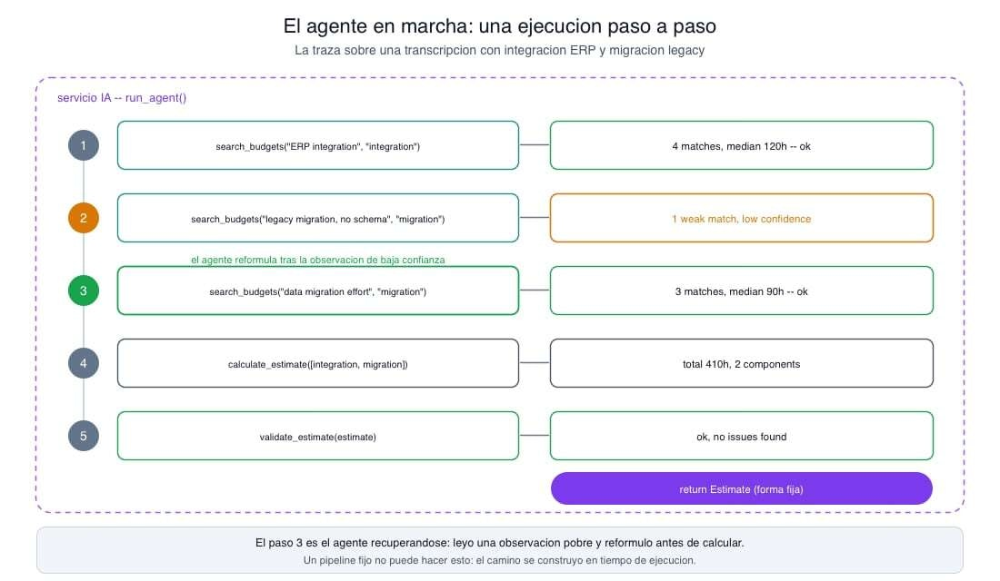
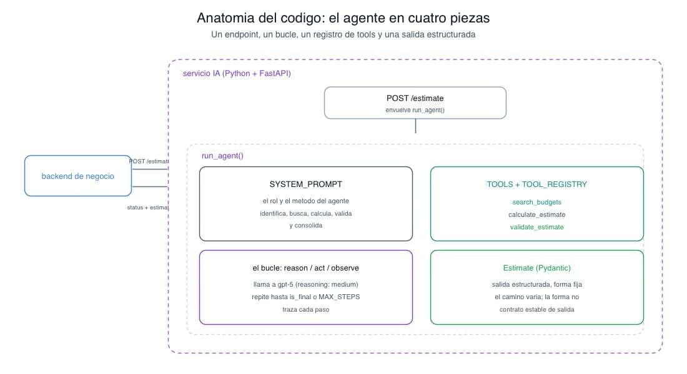

# 📄 El bucle agéntico paso a paso🔴 — 18 min

[Antonio Perez](https://training.lidr.co/members/36030888)

⏳Tiempo estimado: 18 min

Vamos a construir el agente a mano. Sin LangChain, sin ningún framework de orquestación. No porque los frameworks sean malos tienen su sitio, sino porque montar el bucle en crudo es la única forma de entender qué hacen por ti cuando los uses, y de poder tomar el control cuando lo necesites. Un agente de estimación funcional cabe en unas cincuenta líneas. Vamos a ensamblarlas, pieza a pieza, sobre el caso de estimar proyectos software a partir de transcripciones de reunión.

Al final tendrás un agente que lee una transcripción compleja, descompone el proyecto en componentes, busca presupuestos históricos para cada uno, calcula estimaciones parciales, valida el resultado y consolida. Y sabrás exactamente por qué funciona, porque lo habrás escrito tú.

## Las piezas

Cuatro elementos, ni uno más.

Las**tools**son las capacidades ejecutables del agente. Tenemos tres, y cada una envuelve algo que el servicio IA ya sabe hacer:search_budgetsrecupera presupuestos históricos comparables de la base de datos vectorial,calculate_estimatecalcula costes de forma determinista a partir de referencias, yvalidate_estimateaplica comprobaciones de calidad sobre una estimación candidata. El agente no reimplementa nada; solo orquesta.

El**modelo**es el orquestador. Usamosgpt-5con esfuerzo de razonamiento medio: es quien lee la situación y decide qué tool usar en cada momento.

El**bucle**es el esqueleto: llamar al modelo, ejecutar las tools que pida, devolverle los resultados, repetir, hasta que produzca la respuesta final o se agote un límite de pasos.

El**estado**es el contexto que se acumula vuelta a vuelta: cada decisión y cada observación se van añadiendo, y esa acumulación es también la traza que podrás inspeccionar después.

## Las tools y su despacho

Cada tool se declara con un schema que el modelo lee para decidir cuándo y cómo usarla. En la Responses API de OpenAI,search_budgetsse ve así (las otras dos siguen la misma forma):

python
TOOLS=[{"type":"function","name":"search_budgets","description":("Search historical budgets for one software component. Call once per ""component; keep unrelated components in separate calls."),"parameters":{"type":"object","properties":{"query":{"type":"string","description":"One component to price."},"component_type":{"type":"string","enum":["integration","migration","frontend","backend","mobile"],},},"required":["query","component_type"],"additionalProperties":False,},"strict":True,},# calculate_estimate and validate_estimate follow the same structure]

Declarar el schema es solo la mitad. La otra mitad es conectar cada nombre de tool con la función que lo ejecuta, y aquí conviene un patrón sencillo que se paga solo: un registro que mapea nombre a función.

python
from typingimport Any, Awaitable, CallableToolFn= Callable[[dict[str, Any]], Awaitable[dict[str, Any]]]TOOL_REGISTRY:dict[str, ToolFn]={"search_budgets": search_budgets,"calculate_estimate": calculate_estimate,"validate_estimate": validate_estimate,}asyncdefexecute_tool(name:str, args:dict[str, Any])->dict[str, Any]: fn= TOOL_REGISTRY.get(name)if fnisNone:return{"error":f"unknown tool:{name}"}try:returnawait fn(args)except Exceptionas exc:# a failing tool must not crash the loopreturn{"error":str(exc)}

Este registro desacopla dos cosas que no deberían conocerse: qué tools existen y cómo funciona el bucle. Añadir una tool nueva es añadir un schema aTOOLSy una entrada al registro; el bucle no cambia ni una línea. Y fíjate en eltry/except: si una tool falla, no revienta el agente. Devuelve un error*como observación*, y esa es una decisión de diseño importante el modelo puede leer ese error, razonar sobre él y reformular, no un detalle defensivo.

## El bucle

Aquí está el corazón del agente. Es más corto de lo que su reputación sugiere.

python
import asyncioimport jsonfrom openaiimport AsyncOpenAIclient= AsyncOpenAI()MAX_STEPS=8SYSTEM_PROMPT=("You are a software estimation agent. Given a meeting transcript, identify ""the components to estimate, search historical budgets for each one ""separately, compute partial estimates, and consolidate them. Always run ""validate_estimate before producing the final answer.")asyncdefrun_agent(transcript:str)-> AgentResult: trace:list[Step]=[] response=await client.responses.parse( model="gpt-5", reasoning={"effort":"medium"}, instructions=SYSTEM_PROMPT,input=[{"role":"user","content": transcript}], tools=TOOLS, text_format=Estimate,)for _inrange(MAX_STEPS): calls=[itemfor itemin response.outputif item.type=="function_call"]ifnot calls:break# no tool calls: the model has its final answer results=await asyncio.gather(*( execute_tool(call.name, json.loads(call.arguments))for callin calls)) tool_outputs=[]for call, resultinzip(calls, results): trace.append(Step(action=call.name, args=call.arguments, observation=result)) tool_outputs.append({"type":"function_call_output","call_id": call.call_id,"output": json.dumps(result),}) response=await client.responses.parse( model="gpt-5", previous_response_id=response.id, instructions=SYSTEM_PROMPT,input=tool_outputs, tools=TOOLS, text_format=Estimate,)else:return AgentResult(status="max_steps_exceeded", trace=trace)return AgentResult(status="done", estimate=response.output_parsed, trace=trace)

Recorramos las decisiones, porque cada una importa.

La**primera llamada**arranca fuera del bucle con la transcripción como entrada. A partir de ahí, cada iteración empieza mirando la salida del modelo: recogemos todos los items de tipofunction_call. Si no hay ninguno, el modelo ha dejado de pedir tools y ha producido su respuesta final; salimos conbreak.

Si hay llamadas, las**ejecutamos todas en paralelo**conasyncio.gather. Una misma vuelta puede traer varias cuatro componentes, cuatrosearch_budgetsy ejecutarlas concurrentemente en lugar de en serie recorta la latencia de forma notable. Asumir que siempre hay exactamente una es un bug clásico que se manifiesta con la primera transcripción compleja.

Devolvemos**todas**las observaciones juntas, cada una emparejada con sucall_id, en una única llamada de continuación. Elcall_ides lo que empareja tu resultado con la petición correcta; olvidarlo es el error más frecuente al empezar. El estado se encadena conprevious_response_id, de modo que el modelo conserva el contexto sin que reenvíes todo a mano. Reenviamos, eso sí, lasinstructions, porqueprevious_response_idno arrastra el system prompt.

Mientras tanto, cada acción con su observación se va guardando en la**traza**. Esa lista es tu única ventana a lo que el agente decidió y por qué; sin ella, depurar un agente que "a veces estima mal" es imposible.

Y todo el bucle vive dentro de una**guarda**:range(MAX_STEPS). Elelsedelforque se ejecuta solo si el bucle termina sinbreakcaptura el caso en que el agente da vueltas sin converger y corta con un estado explícito de error. Un bucle de agente sin límite de pasos es una factura esperando a dispararse.

## El agente en marcha

La teoría cobra sentido al ver una ejecución. Ante una transcripción que menciona una integración con un ERP y una migración de datos legacy, la traza que va acumulando el agente se lee así:
step 1 search_budgets(query="ERP integration via REST API", component_type="integration") -> 4 matches, median 120hstep 2 search_budgets(query="legacy data migration, undocumented schema", component_type="migration") -> 1 weak match, low confidencestep 3 search_budgets(query="data migration effort, mid-size dataset", component_type="migration") -> 3 matches, median 90hstep 4 calculate_estimate(components=[integration, migration]) -> total 410h across 2 componentsstep 5 validate_estimate(estimate=...) -> ok, no issues found

Lo interesante es el paso 3. En el paso 2 la búsqueda de la migración devolvió una única coincidencia débil, y el agente no calculó sobre ese dato pobre: leyó la observación, reformuló la consulta con otros términos y volvió a buscar antes de seguir. Eso es exactamente lo que un pipeline fijo no puede hacer y lo que justifica el bucle. No lo programaste tú: emergió de que el modelo pudo ver el resultado de su propia acción y decidir el siguiente paso en consecuencia. Ese comportamiento adaptativo, visible paso a paso en la traza, es el agente ganándose su sitio.

## La salida final estructurada

Cuando el modelo deja de pedir tools, produce la estimación final. Y aquí no queremos texto libre: queremos una estructura determinista que el resto del sistema pueda consumir sin sorpresas. Por eso todas las llamadas pasan untext_format, un modelo Pydantic al que la respuesta final debe ceñirse:

python
from pydanticimport BaseModelclassComponentEstimate(BaseModel): name:str hours:float reference_budget_ids:list[str]classEstimate(BaseModel): components:list[ComponentEstimate] total_hours:float notes:str

Cuando el bucle sale porbreak,response.output_parsedya es un objetoEstimatevalidado. Este es el punto clave para la estabilidad del sistema: el agente puede recorrer un camino distinto en cada ejecución tres búsquedas o cinco, un reintento o ninguno, pero la*forma*de lo que devuelve es siempre la misma. La no-determinación vive dentro del bucle; el contrato de salida es determinista.

## El agente detrás de un endpoint

El bucle no se ejecuta en el vacío: vive en el servicio IA, detrás de un endpoint que el resto del sistema invoca. En FastAPI son unas pocas líneas:

python
from fastapiimport FastAPIfrom pydanticimport BaseModelapp= FastAPI()classEstimateRequest(BaseModel): transcript:str@app.post("/estimate")asyncdefestimate(req: EstimateRequest): result=await run_agent(req.transcript)return{"status": result.status,"estimate": result.estimate,"trace":[step.__dict__for stepin result.trace],}

Desde el**backend de negocio**, invocarlo es una llamada HTTP corriente. En la implementación de referencia en Ruby on Rails se ve así, aunque el patrón es independiente del stack y cualquier cliente HTTP sirve igual:

ruby
# backend de negocio: calling the servicio IA (any HTTP client works)response=HTTP.post("#{AI_SERVICE_URL}/estimate",json:{transcript: transcript})result=JSON.parse(response.body)case result["status"]when"done" save_estimate(result["estimate"])when"max_steps_exceeded" flag_for_manual_estimation(result["trace"])end

Fíjate en lo que el backend de negocio*no*ve. No ve el bucle, ni lasfunction_call, ni loscall_id, ni cuántas vueltas dio el agente. Envía una transcripción y recibe unstatusy una estimación estructurada. Todo el mecanismo agéntico es un detalle interno del servicio IA, y esa frontera es lo que te permite reescribir por completo cómo el agente usa sus tools sin tocar una línea del backend de negocio.

## Qué te enseña construirlo a mano

Montar este bucle en crudo deja lecciones que un framework te habría escondido.

La primera es que**el manejo de errores es tuyo, y es donde se juega la robustez**. Una tool puede fallar, el modelo puede devolver algo inesperado, una llamada puede exceder su tiempo. Eltry/exceptdel despacho convierte un fallo de tool en una observación recuperable; la guardaMAX_STEPSimpide el bucle infinito; elstatusde salida distingue el éxito del agotamiento. Ninguna de estas defensas es opcional en producción, y todas son visibles y ajustables porque las escribiste tú.

La segunda es que**la observabilidad no viene gratis**. La traza que vas acumulando es tu instrumento de depuración, y su calidad determina si podrás entender por qué el agente hizo lo que hizo. En un sistema real querrás enriquecerla: tiempos por paso, tokens consumidos, el resumen de razonamiento del modelo. Pero la estructura básica acción, argumentos, observación, por vuelta ya está aquí.

La tercera es que ahora**entiendes lo que un framework haría por ti**. Cuando te plantees adoptar uno, verás que en buena medida te ofrece exactamente este bucle, más gestión de estado, reintentos, instrumentación y, en los más elaborados, orquestación como grafo de ejecución. Puede que lo quieras; puede que no. La diferencia es que ahora es una decisión informada, no un acto de fe. Has visto la máquina por dentro y sabes qué partes te está automatizando.

## Cierre: cincuenta líneas y ni una de magia

Recapitula lo que has construido: un bucle, un registro de tools, un system prompt y un esquema de salida. Eso es el agente entero. Cada punto de decisión es tuyo cuántos pasos permites, qué haces cuando una tool falla, qué devuelves cuando no converge, cada pieza se puede testear por separado, y cada vuelta queda registrada en la traza.

No hay una capa oculta donde ocurra algo que no puedas explicar. El razonamiento lo pone el modelo; el control de flujo, tú. Y esa es exactamente la sensación que buscábamos: mirar algo que suena a autonomía inteligente y reconocer, debajo, un buclewhilebien escrito con una condición de parada. Los frameworks son comodidades construidas sobre esto. Tú ya entiendes la cosa que envuelven.

## Fuentes

- 

OpenAI,*Function calling*(Responses API) itemsfunction_call/function_call_output,call_idy encadenado conprevious_response_id:[https://developers.openai.com/api/docs/guides/function-calling](https://developers.openai.com/api/docs/guides/function-calling)

- 

OpenAI,*Structured outputs*salida ceñida a un schema estricto context.format/parse:[https://platform.openai.com/docs/guides/structured-outputs](https://platform.openai.com/docs/guides/structured-outputs)

- 

Anthropic,*How tool use works*la forma canónica del bucle gobernado por una condición de parada:[https://platform.claude.com/docs/en/agents-and-tools/tool-use/how-tool-use-works](https://platform.claude.com/docs/en/agents-and-tools/tool-use/how-tool-use-works)
