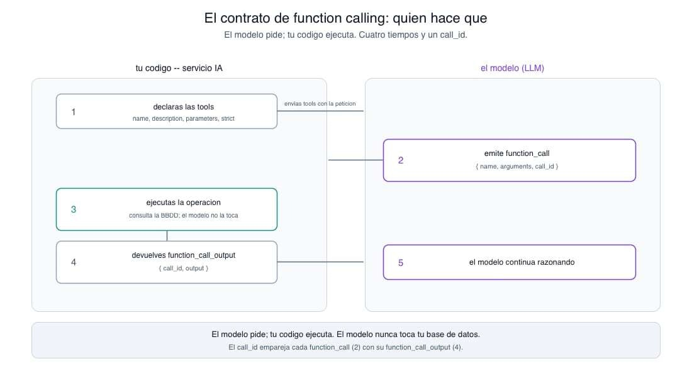
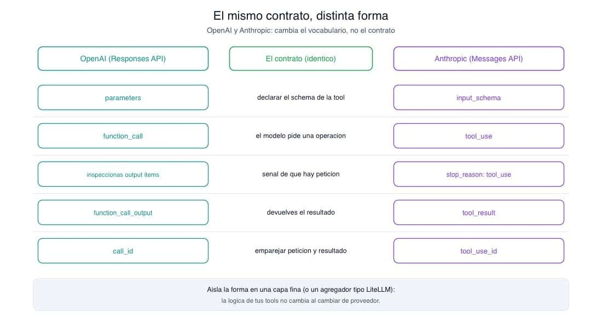

# 📄 Function calling en la práctica: tools, schemas y contrato con el modelo🔴 — 21 min

[Antonio Perez](https://training.lidr.co/members/36030888)

⏳Tiempo estimado: 21 min

Un agente que solo razona no sirve de mucho. Para estimar un proyecto necesita hacer cosas: recuperar presupuestos históricos parecidos, calcular costes a partir de esas referencias, validar que el resultado tiene sentido. Function calling es el mecanismo por el que un modelo pasa de hablar a actuar, y es, con diferencia, la pieza más útil del kit de un agente. También es la que más se malentiende.

Así que empecemos matando el malentendido de raíz, porque contamina todo lo demás:**el modelo no ejecuta tu código.**Nunca. Ni consulta tu base de datos, ni corre tu función de cálculo, ni toca nada. Lo único que hace es emitir una petición estructurada —"quiero llamar asearch_budgetscon estos argumentos"— y tu código decide qué hacer con ella. Function calling no es el modelo ejecutando funciones; es el modelo pidiéndote que las ejecutes tú. Interiorizar esto cambia cómo diseñas todo el sistema.

Para lo que sigue, situemos el terreno. El servicio IA tiene operaciones que el agente necesita ejecutar durante una estimación:search_budgetsrecupera presupuestos históricos comparables,calculate_estimatecalcula costes a partir de referencias,validate_estimateaplica comprobaciones sobre el resultado. Para que el modelo pueda invocarlas, las declaramos como tools. Veamos exactamente qué significa eso.

## El contrato: quién hace qué

Function calling es un contrato entre tu código y el modelo, y tiene cuatro tiempos.

Primero, tú**declaras**las tools disponibles: qué operaciones existen y qué forma tienen sus entradas. Segundo, el modelo, si decide que necesita una,**emite una petición estructurada**con el nombre de la tool y los argumentos. Tercero, tu código**ejecuta**la operación: aquí es donde de verdad se consulta la base de datos vectorial o se corre el cálculo. Cuarto, devuelves el resultado al modelo, que**continúa**razonando con ese dato nuevo en la mano.

Visto así, esto no es exótico. Es una interfaz tipada de manual: declaras un esquema, alguien te pide una operación conforme a ese esquema, la ejecutas, devuelves el resultado. La única diferencia con cualquier API que hayas integrado es quién está al otro lado pidiendo: un modelo de lenguaje que elige la función según la conversación, en lugar de un cliente con un flujo fijo. Un ingeniero con experiencia en APIs integra function calling igual que integraría cualquier interfaz: define el esquema, maneja el callback, devuelve un resultado. Ese es el modelo mental correcto, y es tranquilizadoramente familiar.

Un ejemplo lo aterriza. El modelo lee una transcripción que menciona una integración con un ERP. En lugar de inventarse un coste, emite una petición: llamar asearch_budgetscon unqueryque describe la integración ycomponent_typeigual a"integration". Tu código recibe esa petición, ejecuta la recuperación real sobre la base de datos vectorial, y devuelve los presupuestos históricos encontrados. El modelo, ahora con datos reales delante, razona sobre ellos y decide el siguiente paso. En ningún momento el modelo tocó la base de datos: pidió, ejecutaste tú, devolviste tú. Ese reparto de responsabilidades es todo el mecanismo.

## Anatomía de una tool: nombre, descripción, parámetros, schema

Una tool se define con cuatro piezas, y conviene tratarlas con el respeto que merecen porque el modelo solo ve esto —nunca tu implementación—.

- 

**Nombre.**Un identificador único. Cuando la biblioteca de tools crece, conviene un namespace que desambigüe (budgets_search,estimate_calculate) para que la elección no sea ambigua.

- 

**Descripción.**Lo que el modelo lee para decidir*cuándo*y*cómo*usar la tool. Es, con diferencia, la pieza de mayor apalancamiento, y volveremos sobre ella.

- 

**Parámetros.**Definidos como JSON Schema: tipos, campos requeridos, enums, y una descripción por parámetro.

- 

**Schema estricto.**Constrict: true, los argumentos que genera el modelo se ciñen exactamente al JSON Schema que declaraste.

En la Responses API de OpenAI, una tool se ve así:

python
TOOLS = [ { "type": "function", "name": "search_budgets", "description": ( "Search historical project budgets for items comparable to a single " "software component. Call this once per component; do not combine " "unrelated components (for example, an ERP integration and a data " "migration) into one query." ), "parameters": { "type": "object", "properties": { "query": { "type": "string", "description": "A focused description of one component to price.", }, "component_type": { "type": "string", "enum": ["integration", "migration", "frontend", "backend", "mobile"], "description": "Category of the component, used to filter results.", }, }, "required": ["query", "component_type"], "additionalProperties": False, }, "strict": True, }, ]

Fíjate en cuánta intención hay en la descripción y en los enums. No están para documentar: están para dirigir el comportamiento del modelo. Elenumdecomponent_typerestringe lo que el modelo puede pasar; la instrucción de "una llamada por componente" dentro de la descripción es lo que evita que el modelo meta la integración y la migración en una sola búsqueda y reciba un revoltijo inútil. El schema no solo valida: enseña.

## El ida y vuelta en la Responses API

Con las tools declaradas, el intercambio es directo. Llamas al modelo pasándole la entrada y las tools; el modelo responde, y si decide actuar, su salida contiene un item de tipofunction_call.

python
import json from openai import OpenAI client = OpenAI() response = client.responses.create( model="gpt-5", reasoning={"effort": "medium"}, input=[{"role": "user", "content": transcript}], tools=TOOLS, ) for item in response.output: if item.type == "function_call": args = json.loads(item.arguments) result = execute_tool(item.name, args) # your code runs the operation response = client.responses.create( model="gpt-5", previous_response_id=response.id, input=[{ "type": "function_call_output", "call_id": item.call_id, "output": json.dumps(result), }], tools=TOOLS, )

Tres cosas que conviene no pasar por alto. La primera: la salida de la Responses API no es un simple texto, es una lista de items tipados, y lasfunction_callson uno de esos tipos; tienes que recorrerresponse.outpute inspeccionar cada item por sutype, no asumir que el primero es la respuesta. La segunda: cadafunction_calltrae uncall_id, y cuando devuelves el resultado confunction_call_outputtienes que referenciar ese mismocall_id. Es lo que empareja tu resultado con la petición correcta, y olvidarlo es el error más común al empezar. La tercera: el estado se encadena conprevious_response_id, de modo que el modelo mantiene el contexto de la vuelta anterior sin que tengas que reenviarlo todo a mano.

Este intercambio se repite: mientras el modelo siga pidiendo tools, tú ejecutas y devuelves; cuando deja de pedirlas y produce la respuesta final, has terminado. Ese es el bucle, y la mecánica de cada vuelta es exactamente la de arriba.

Un aviso concreto que ahorra una hora de depuración: en la Responses API el schema de la tool es plano —type,name,descriptionyparametersal mismo nivel—. Si vienes de la Chat Completions API, allí el schema va anidado bajo una clavefunction. Copiar el formato de una a otra devuelve un error de parámetro que no siempre es obvio.

## Llamadas en paralelo

Una misma respuesta del modelo puede contener no una, sino variasfunction_call. Es habitual y deseable: ante una transcripción con cuatro componentes independientes, el modelo puede pedir cuatrosearch_budgetsde golpe —uno por componente— en lugar de encadenarlos de uno en uno. Ejecutarlos concurrentemente y devolver los cuatro resultados juntos recorta la latencia de forma notable frente a cuatro vueltas secuenciales, y es una de las optimizaciones más baratas que vas a encontrar.

El matiz de implementación importa. Cuando hay varias llamadas en una vuelta, no contestas una y vuelves a llamar por cada una: recoges todas lasfunction_callde la respuesta, ejecutas cada operación —idealmente conasyncio.gather, ya que las tools del servicio IA son asíncronas— y devuelves todos losfunction_call_output, cada uno con sucall_id, en una única petición de continuación. El bucle más simple maneja bien el caso de una sola llamada; en cuanto asumes que puede haber varias, la forma correcta es juntar las salidas antes de reanudar. Dar por hecho que siempre hay exactamente una es otra fuente clásica de bugs sutiles: funciona en tus pruebas con transcripciones simples y se rompe con la primera reunión compleja.

## El mismo contrato en otro proveedor

Function calling no es de OpenAI; es un patrón que cada proveedor implementa con su propia forma. En la API de Anthropic, la misma tool se declara coninput_schemaen lugar deparameters:

python
tools = [ { "name": "search_budgets", "description": "Search historical project budgets for one software component.", "input_schema": { "type": "object", "properties": { "query": {"type": "string", "description": "One component to price."}, "component_type": {"type": "string"}, }, "required": ["query", "component_type"], }, }, ]

Y el resto del vocabulario cambia en paralelo: el modelo devuelve bloquestool_use(no itemsfunction_call), la respuesta llega constop_reason: "tool_use", y tú contestas con un bloquetool_result(no unfunction_call_output). Los nombres son distintos; el contrato es idéntico. Declaras un esquema, el modelo pide una operación conforme a él, tú la ejecutas, devuelves el resultado, el modelo sigue.

Que el contrato sea el mismo y solo cambie la forma tiene una consecuencia arquitectónica que merece la pena aprovechar: puedes aislar esas diferencias de transporte en una capa fina, o delegarlas en un agregador, y mantener la lógica de tus tools —qué hacesearch_budgets, qué devuelve— completamente independiente del proveedor. Tus funciones no cambian; solo cambia el adaptador que traduce entre tu esquema y el de cada API. Es la misma portabilidad que buscarías con cualquier dependencia externa, aplicada al proveedor de modelo.

## Dónde vive todo esto

Toda esta maquinaria vive dentro del**servicio IA**, en Python. Las tools no son operaciones nuevas: son la exposición, como funciones invocables por el modelo, de capacidades que el servicio IA ya tiene.search_budgetsenvuelve la recuperación sobre la base de datos vectorial;calculate_estimate, la lógica determinista de costes;validate_estimate, las comprobaciones de calidad sobre el resultado. Declarar una tool es, en la práctica, escribir su schema y conectar su ejecución a una función que ya existía.

El**backend de negocio**no participa en nada de esto. No declara tools, no vefunction_callnitool_use, no gestionacall_id. Envía una transcripción al endpoint del servicio IA y recibe una estimación estructurada. Todo el intercambio de function calling —las vueltas, los argumentos, los resultados— es un detalle interno del servicio IA, invisible desde fuera. Esa frontera es lo que te permite cambiar por completo cómo el agente usa sus tools sin tocar una línea del backend de negocio.

## Diseñar tools que el modelo use bien

La mecánica es fácil; que el modelo use tus tools*bien*es donde está el trabajo real. Y casi todo se reduce a dos superficies: la descripción, que gobierna la entrada, y el resultado, que gobierna la siguiente decisión.

**La descripción es la interfaz.**El modelo elige la tool y rellena sus argumentos leyendo solo la descripción y el schema. Si el modelo escoge la tool equivocada o inventa argumentos raros, la causa casi nunca es el modelo: es una descripción vaga. Escríbela para un lector que no ve tu código y solo tiene esas frases para decidir. Unenumbien puesto o una restricción explícita —"una llamada por componente"— hacen más por la fiabilidad que cualquier ajuste de temperatura.

**Los resultados deben ser de alto valor.**Devuelve solo lo que el modelo necesita para decidir el siguiente paso, con identificadores estables y semánticos, no un volcado de doscientas filas de presupuesto en crudo. Un resultado inflado desperdicia contexto —que además reenvías en cada vuelta— y confunde al modelo. Menos y más limpio es mejor.

**Los errores también son resultados, y de los importantes.**Cuandosearch_budgetsno encuentra nada útil, devuélvelo como una observación con información —"1 coincidencia débil, baja confianza para la migración legacy"— y el modelo podrá razonar y reformular. Devuelve un genérico "error" y el modelo se queda ciego. Un mensaje de error informativo es lo que permite a un agente recuperarse de sus propios tropiezos.

**Valida los argumentos antes de ejecutar lo que duele.**strict: truete garantiza que los argumentos tienen la*forma*del schema, no que tengan*sentido*. Para una tool de solo lectura comosearch_budgets, ejecutar directamente es aceptable. Para una acción con efectos —persistir, enviar, mover algo—, añade una capa de validación tuya sobre los argumentos que el modelo propone antes de ejecutarlos. El schema es una guarda de tipos, no un sustituto del criterio.

**Cuida la granularidad.**Es una decisión de diseño que se pasa por alto y que afecta directamente a la fiabilidad de la elección. Demasiadas tools con contornos solapados confunden al modelo, que duda entre cuál usar; muy pocas y demasiado genéricas le obligan a hacer malabares con argumentos para expresar lo que quiere. El punto dulce suele ser una tool por operación con límites nítidos:search_budgetsbusca,calculate_estimatecalcula,validate_estimatevalida, y ninguna invade el terreno de la otra. Si te descubres explicando en la descripción cuándo*no*usar una tool, quizá esa tool esté haciendo demasiadas cosas.

## Cierre: una interfaz tipada con un cliente inusual

Puestas las piezas, function calling deja de ser un mecanismo de IA y se revela como lo que es: una interfaz tipada cuyo cliente resulta ser un modelo. Declaras el esquema, manejas el callback, devuelves el resultado. La disciplina es la de siempre —contratos claros, validación de entradas, errores informativos, respuestas de alto valor—, y no hay nada de eso que no hayas hecho ya integrando cualquier API.

Lo único genuinamente nuevo es que quien elige la función y rellena sus argumentos es el modelo, a partir de una descripción en lenguaje natural. Y ahí está la palanca: la fiabilidad de tus tools no vive en un modelo mejor, vive en descripciones y resultados mejores. Eso es ingeniería de interfaces, no aprendizaje automático. Diseña la tool como diseñarías una buena API para un compañero que solo va a leer la firma y la documentación porque, en esencia, eso es exactamente lo que el modelo va a hacer.

## Fuentes

- 

OpenAI,*Function calling*(Responses API) — schema plano, itemsfunction_call/function_call_output,call_idystrict:[https://developers.openai.com/api/docs/guides/function-calling](https://developers.openai.com/api/docs/guides/function-calling)

- 

OpenAI,*Migrate to the Responses API*— diferencias de forma respecto a Chat Completions:[https://platform.openai.com/docs/guides/migrate-to-responses](https://platform.openai.com/docs/guides/migrate-to-responses)

- 

Anthropic,*How tool use works*— el contrato de la tool como interfaz tipada y los bloquestool_use/tool_result:[https://platform.claude.com/docs/en/agents-and-tools/tool-use/how-tool-use-works](https://platform.claude.com/docs/en/agents-and-tools/tool-use/how-tool-use-works)

- 

Anthropic,*Define tools*— descripciones efectivas, namespacing y resultados de alto valor:[https://platform.claude.com/docs/en/agents-and-tools/tool-use/implement-tool-use](https://platform.claude.com/docs/en/agents-and-tools/tool-use/implement-tool-use)
