# Sesión 13: Orquestación de agentes — 76 min

[Antonio Perez](https://training.lidr.co/members/36030888)

⏳Tiempo estimado: 2 min

[Video](https://player.vimeo.com/video/1200715792?h=d4075ef446)

Tu RAG ya funciona: recupera presupuestos parecidos a lo que buscas. Pero parecido no es lo mismo que útil, y cuando el sistema te devuelve una app de pagos al pedirle una plataforma de e-commerce, estás a un paso de una mala estimación. En esta sesión convertimos una recuperación aceptable en una recuperación precisa, y lo demostramos con números, no con sensaciones.

**En esta sesión descubrirás:**

→ Por qué la búsqueda vectorial ordena mal los resultados finos y cómo el reranking con cross-encoders reordena los candidatos leyendo consulta y documento juntos

→ Cómo combinar búsqueda semántica y búsqueda por palabras exactas con full-text search en PostgreSQL, y cómo fusionar ambos rankings con Reciprocal Rank Fusion

→ Cómo medir con un golden set propio si cada técnica compensa su coste en latencia, antes de llevarla a producción

→ Cómo descomponer consultas complejas en sub-búsquedas y dirigir cada una al índice correcto mediante routing

→ Cómo el filtrado por metadatos y el decaimiento temporal evitan que un presupuesto obsoleto contamine tus estimaciones

Para finalizar, añade tu opinión sobre el contenido y el ejercicio de este módulo🆙

### 
❗Obtén los recursos completos en las siguientes lecciones👇

- 

[✍️ Ejercicio: Orquestación de agentes🔴

- Visibility: Visible
- Unlocking: None
- Completion: Button
- Comments: On
- Thumbnail: Default
](https://training.lidr.co/posts/ai-engineering-202604-✍️-ejercicio-orquestacion-de-agentes🔴)🚨 La fecha límite: Martes 14 de Julio a las 23:59 de tu hora local. Objetivo Reexpresar el flujo de estimación del...
- 

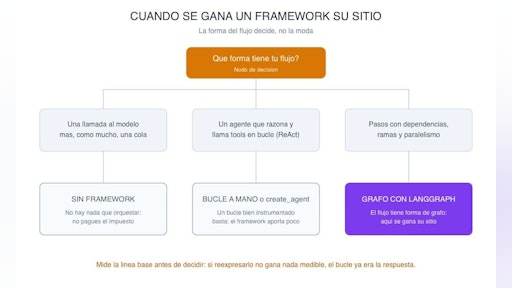

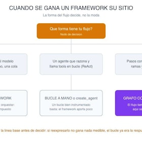

[📄 Del bucle manual al grafo: cuando necesitamos un framework 🔴 — 16 min

- Visibility: Visible
- Unlocking: None
- Completion: Button
- Comments: On
- Thumbnail: Default
](https://training.lidr.co/posts/ai-engineering-202604-📄-del-bucle-manual-al-grafo-cuando-necesitamos-un-framework-🔴-16-min)⏳ Tiempo estimado: 16 min El sistema de estimación tiene hoy una capa agéntica construida a mano: un bucle sobre el...
- 

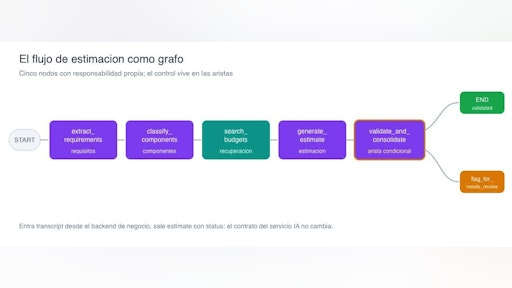

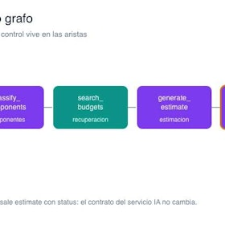

[📄 LangGraph desde cero: StateGraph, nodos, aristas y estado 🔴 — 13 min

- Visibility: Visible
- Unlocking: None
- Completion: Button
- Comments: On
- Thumbnail: Default
](https://training.lidr.co/posts/ai-engineering-202604-📄-langgraph-desde-cero-stategraph-nodos-aristas-y-estado-🔴-13-min)⏳ Tiempo estimado: 13 min El flujo de estimación, contado como una lista de pasos, es sencillo de enunciar: de la...
- 

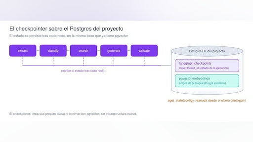

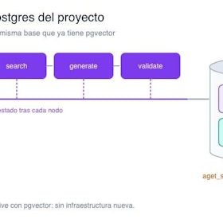

[📄 Estado y persistencia: reducers, checkpointers y memoria 🔴 — min

- Visibility: Visible
- Unlocking: None
- Completion: Button
- Comments: On
- Thumbnail: Default
](https://training.lidr.co/posts/ai-engineering-202604-📄-estado-y-persistencia-reducers-checkpointers-y-memoria-🔴-min)⏳ Tiempo estimado: 13 min Un grafo con estado tipado y nodos bien delimitados ya se lee de un vistazo. Pero si ese...
- 

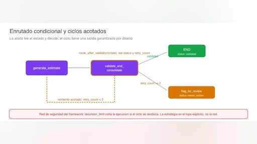

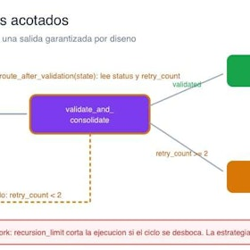

[📄 Ejecución paralela y enrutado condicional 🔴 — 12 min

- Visibility: Visible
- Unlocking: None
- Completion: Button
- Comments: On
- Thumbnail: Default
](https://training.lidr.co/posts/ai-engineering-202604-📄-ejecucion-paralela-y-enrutado-condicional-🔴-12-min)⏳ Tiempo estimado: 12 min De los cinco pasos del flujo de estimación, hay uno que arrastra al resto: la búsqueda de...
- 

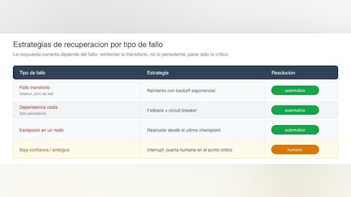

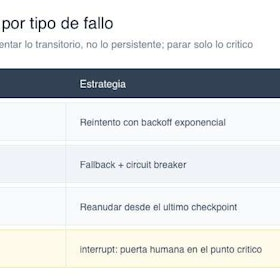

[📄 Manejo de errores y recuperación en flujos complejos🔴 — 12 min

- Visibility: Visible
- Unlocking: None
- Completion: Button
- Comments: On
- Thumbnail: Default
](https://training.lidr.co/posts/ai-engineering-202604-📄-manejo-de-errores-y-recuperacion-en-flujos-complejos🔴-12-min)⏳ Tiempo estimado: 12 min El flujo de estimación ya es rápido y flexible: paraleliza lo independiente y decide su...
- 

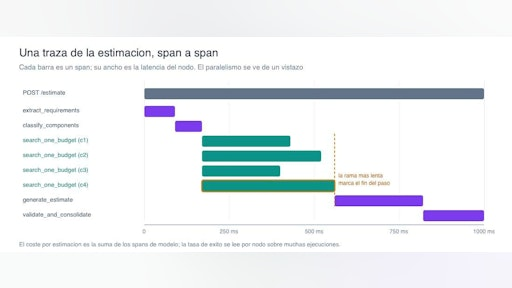

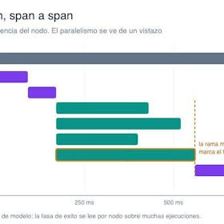

[📄 Observabilidad: LangSmith y Logfire para el servicio IA 🔴 — 10 min

- Visibility: Visible
- Unlocking: None
- Completion: Button
- Comments: On
- Thumbnail: Default
](https://training.lidr.co/posts/ai-engineering-202604-📄-observabilidad-langsmith-y-logfire-para-el-servicio-ia-🔴-10-min)⏳ Tiempo estimado: 10 min A lo largo de todo lo anterior ha aparecido una y otra vez la misma exigencia: mide antes...
- 

[🆙 Evalúa el contenido de este Módulo

- Visibility: Visible
- Unlocking: None
- Completion: None
- Comments: On
- Thumbnail: Default
](https://training.lidr.co/posts/ai-engineering-202604-🆙-evalua-el-contenido-de-este-modulo-98724363)Evalúa del 1 al 5 el valor aportado por el contenido del módulo actual. Si al enviar la encuesta te aparece algún...
