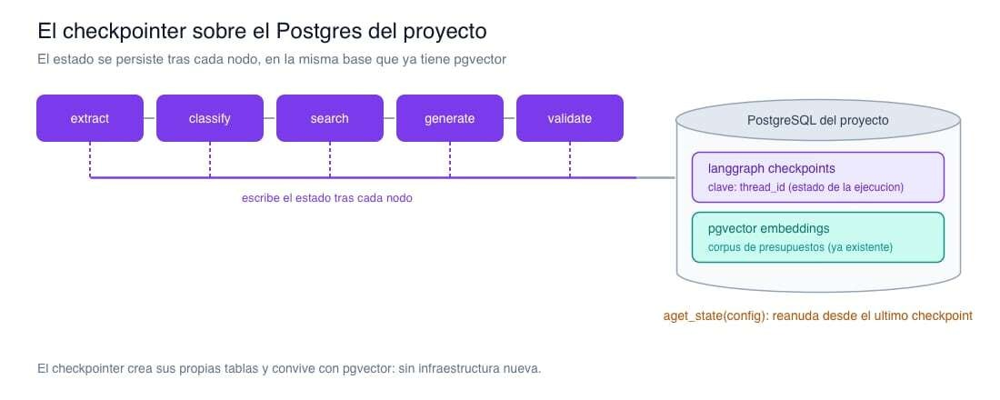
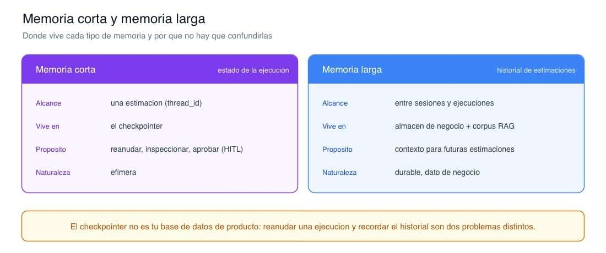

# 📄 Estado y persistencia: reducers, checkpointers y memoria 🔴 — min

[Antonio Perez](https://training.lidr.co/members/36030888)

⏳Tiempo estimado: 13 min

Un grafo con estado tipado y nodos bien delimitados ya se lee de un vistazo. Pero si ese estado vive solo en memoria, el sistema tiene un punto ciego: basta con que el proceso se reinicie a mitad de una estimación, un despliegue, un fallo, un timeout, para que todo el trabajo hecho hasta ahí se pierda. En un flujo corto quizá no duela; en uno que recupera presupuestos para varios componentes y consolida una estimación, empezar de cero cada vez que algo se cae no es aceptable.

Persistir el estado es lo que convierte el grafo en algo que aguanta producción. Y hay un dato que ordena las prioridades: según el informe de ingeniería de agentes de LangChain de 2026, más del 60% de los incidentes de agentes en producción se originan en la gestión de estado. No en el modelo, no en el prompt: en el estado. Este artículo trata precisamente eso: cómo se combina el estado (reducers), cómo se persiste (checkpointers) y qué tipo de memoria es cada cosa.

## Reducers: cómo se combina cada actualización

Cuando un nodo devuelve una actualización parcial, LangGraph tiene que decidir cómo integrarla en el estado. Esa decisión la gobierna el**reducer**del campo.

Por defecto, un campo se**sobrescribe**: el último valor que se escribe manda. Es lo correcto parastatusoestimate, donde solo importa el valor final. Para otros campos quieres**acumular**, y ahí es donde el reducer cambia el comportamiento:

python
from typingimport Annotated, TypedDictimport operatorclassEstimationState(TypedDict): budget_matches: Annotated[list[BudgetMatch], operator.add]# accumulates status:str# overwrites

La distinción no es cosmética: un campo acumulador**sobrevive a los reinicios**combinándose con lo que ya había, mientras que un campo de sobrescritura toma su último valor escrito. Y hay un detalle que muerde en producción. Cuando reanudas una ejecución desde un checkpoint y le pasas un estado inicial que**incluye campos acumuladores**, el reducer no reemplaza:**combina**. El resultado es que puedes duplicar los datos sin darte cuenta, los presupuestos aparecen dos veces, porque eloperator.addconcatena lo que le pasas con lo que ya estaba guardado. La regla es simple: al reanudar, pasa solo las entradas nuevas, nunca los campos acumulados.

## Checkpointers: persistir sin escribir una capa de base de datos

Un checkpointer persiste el estado**tras la ejecución de cada nodo**. Eso es lo que hace posible pausar, reanudar, inspeccionar la ejecución paso a paso y, más adelante, parar en un punto para que un humano apruebe. Y lo da sin que tengas que escribir tú una capa de persistencia.

Hay varios backends.InMemorySaverpara desarrollo y tests.SqliteSaverpara un único servidor. YPostgresSaver(con su variante asíncronaAsyncPostgresSaver) para producción con varias instancias. Como el servicio IA es asíncrono, FastAPI sobre asyncpg, la variante que casa es la asíncrona.

Lo importante para el proyecto:**el checkpointer se apoya en el mismo PostgreSQL que ya usa el sistema**, ese que tiene la extensión pgvector con los embeddings. El checkpointer crea sus propias tablas y convive sin roces con las de la base vectorial. No hay infraestructura nueva que levantar.

python
from langgraph.checkpoint.postgres.aioimport AsyncPostgresSaverfrom psycopg_poolimport AsyncConnectionPool# At service startup: one pool over the project's Postgres (the pgvector one).pool= AsyncConnectionPool(conninfo=DATABASE_URL, max_size=10,open=False)await pool.open()checkpointer= AsyncPostgresSaver(pool)await checkpointer.setup()# run once: creates the checkpoint tablesgraph= builder.compile(checkpointer=checkpointer)

La pieza que ata cada ejecución a su historia es elthread_id. Se pasa en la configuración de la invocación, y es la clave bajo la que se guardan los checkpoints de esa ejecución:

python
config={"configurable":{"thread_id": estimation_id}}result=await graph.ainvoke({"transcript": transcript}, config)# Same thread_id resumes from the last checkpoint instead of starting over.snapshot=await graph.aget_state(config)

Mismothread_id, misma historia: la ejecución se reanuda desde el último checkpoint.thread_iddistinto, ejecución nueva y limpia. Usa comothread_idel identificador de la estimación, y cada estimación tendrá su rastro persistente y reanudable.

## Memoria corta y memoria larga no son lo mismo

Aquí es donde conviene ser preciso, porque "memoria" se usa para dos cosas distintas y confundirlas lleva a malas decisiones de arquitectura.

La**memoria a corto plazo**es el estado de una ejecución: lo que dura una estimación concreta, atado a suthread_id. Vive en el checkpointer. Su propósito es operativo —reanudar, inspeccionar, permitir una aprobación humana— y es, por naturaleza, efímera: cuando la estimación se cierra, ese estado ya no aporta valor de producto.

La**memoria a largo plazo**es otra cosa: el historial de estimaciones a lo largo del tiempo, que sirve de contexto para futuras estimaciones. Eso es dato de negocio, durable, que atraviesa sesiones y ejecuciones. Y no es trabajo del checkpointer. El checkpointer está pensado para el estado de una ejecución, no para ser tu almacén de memoria entre sesiones.

De ahí una posición de arquitectura que encaja con la separación de capas del sistema:**el checkpointer no es tu base de datos de producto**. El historial de estimaciones —lo que el sistema aprende de proyectos pasados— vive donde vive el dato de negocio y el corpus que alimenta la recuperación, no en las tablas de checkpoints. Si lo único que necesitas es el resultado final de una ejecución para guardarlo como estimación histórica, guárdalo en el almacén de negocio; es más simple y es donde corresponde. El checkpointer resuelve el "reanuda esta ejecución donde se quedó"; el historial resuelve el "qué sabemos de estimaciones anteriores". Son dos problemas, y mezclarlos ensucia los dos.

## El coste de un estado gordo

Todo lo que metes en el estado se serializa al almacén de checkpoints**en cada transición entre nodos**. Esa frase tiene una consecuencia directa en producción: el tamaño del estado es una decisión de rendimiento, no solo de diseño.

Un estado ligero —identificadores, hallazgos ya destilados, campos de enrutado— se serializa en milisegundos. Un estado que arrastra respuestas crudas del modelo con todos sus metadatos crece rápido: se han visto estados de cientos de kilobytes, incluso megabytes, donde la escritura del checkpoint pasa de unos pocos milisegundos a varios cientos y se convierte en el cuello de botella real de la ejecución. El agente no va lento por el modelo: va lento porque en cada paso está serializando un objeto enorme.

La disciplina es la misma que hace el grafo legible: guarda en el estado lo mínimo para razonar y enrutar —IDs, resultados destilados, banderas—, y deja lo transitorio y voluminoso fuera, en el ámbito de la función. Un estado mínimo y tipado se persiste barato, se inspecciona fácil y se reanuda rápido. Es la misma decisión que la del esquema de estado, vista ahora desde el coste de serialización.

## El siguiente paso

Con reducers que combinan bien, un checkpointer sobre el Postgres que ya tenemos y una idea clara de qué es memoria de ejecución y qué es dato de negocio, el grafo ya no pierde el hilo: sobrevive a un reinicio, se puede inspeccionar paso a paso y distingue lo efímero de lo durable. Sobre esa base de estado persistente se pueden construir cosas que un bucle plano no permitía: ejecutar en paralelo lo que no depende entre sí —la búsqueda de presupuestos por componente— y enrutar de forma condicional según lo que el estado vaya diciendo. Ese es el siguiente terreno.

## Resumen

- 

**El reducer decide cómo se combina cada actualización.**Sobrescritura por defecto (status,estimate); acumulación conoperator.add(budget_matches). Cuidado al reanudar: pasar campos acumuladores en el estado inicial los duplica.

- 

**El checkpointer persiste el estado tras cada nodo**y da pausa, reanudación e inspección sin escribir una capa de base de datos.AsyncPostgresSaveres la variante que casa con el stack asíncrono del servicio IA.

- 

**Reutiliza el Postgres del proyecto.**El checkpointer crea sus tablas y convive con pgvector; no hay infraestructura nueva. Elthread_idata cada ejecución a su historia y la hace reanudable.

- 

**Memoria corta y larga son problemas distintos.**La corta (estado de la ejecución) vive en el checkpointer y es efímera; la larga (historial de estimaciones) es dato de negocio durable y vive donde vive el dato de negocio. El checkpointer no es tu base de datos de producto.

- 

**El tamaño del estado es rendimiento.**Todo se serializa en cada transición: estado ligero, escrituras en milisegundos; estado gordo, el checkpoint se vuelve el cuello de botella.

## Referencias

- 

LangGraph - persistencia y checkpointers:https://docs.langchain.com/oss/python/langgraph/persistence

- 

LangGraph - memoria a corto y largo plazo:https://docs.langchain.com/oss/python/langgraph/memory

- 

Diseño de esquema de estado y checkpointers en producción:https://www.kalviumlabs.ai/blog/langgraph-in-production-stateful-multi-step-agents/
