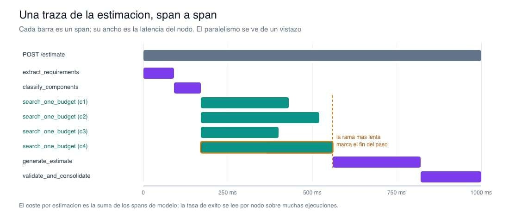
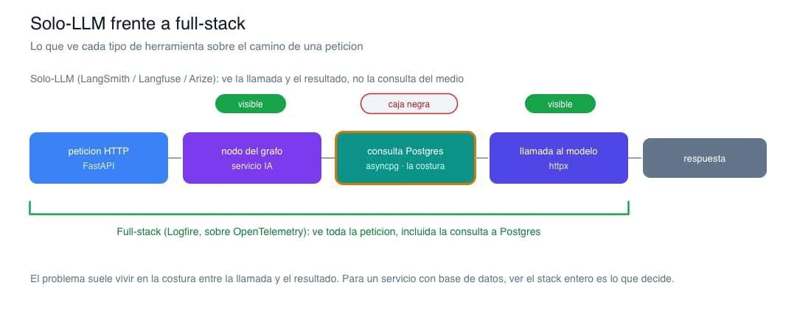

# 📄 Observabilidad: LangSmith y Logfire para el servicio IA 🔴 — 10 min

[Antonio Perez](https://training.lidr.co/members/36030888)

⏳Tiempo estimado: 10 min

A lo largo de todo lo anterior ha aparecido una y otra vez la misma exigencia: mide antes de decidir. ¿El framework se gana su sitio? Mide la línea base. ¿Merece la pena paralelizar? Compara el antes y el después. ¿Qué hacer robusto? Mira dónde falla de verdad. Todas esas preguntas comparten un supuesto que hasta ahora hemos dejado en el aire: que puedes ver la ejecución por dentro. No puedes decidir qué optimizar si no sabes cuánto tarda cada nodo, no puedes saber si una estrategia de recuperación funciona si no ves qué falla, y no puedes hablar de coste si no lo mides por estimación.

Ese es el último tramo del grafo: la observabilidad. No es un extra que se añade al final; es la instrumentación que convierte un grafo que funciona en un grafo del que sabes cosas.

## Qué es observar un flujo agéntico

La unidad básica es el**span**: un tramo de la ejecución con un nombre, un inicio, un fin y unos atributos. Un span mide cuánto tardó una operación y qué pasó dentro. Los spans se organizan en un árbol —una**traza**— que refleja las relaciones padre/hijo: la petición contiene la ejecución del grafo, que contiene cada nodo, que contiene la llamada al modelo o la consulta a la base. Sobre esa estructura se calculan las**métricas**que importan en este flujo: latencia por nodo, tasa de éxito por nodo y coste por estimación.

Un grafo se presta especialmente bien a esto porque los nodos ya son las unidades naturales de medida. Un span por nodo te dice, de un vistazo, dónde se va el tiempo.

## Dos herramientas, dos filosofías

Hay dos herramientas de referencia, y la diferencia entre ellas no es de calidad sino de alcance.

**LangSmith**, de LangChain, es una plataforma de trazabilidad, evaluación y depuración pensada para agentes. Traza la ejecución de un grafo de forma nativa, la ejecución aparece como un árbol navegable, y añade evaluación como ciudadano de primera clase. Es agnóstica del framework, pero su encaje más natural es cuando ya estás dentro del ecosistema LangChain. Activarla es sobre todo configuración de entorno:
LANGSMITH_TRACING=trueLANGSMITH_API_KEY=...LANGSMITH_PROJECT=estimation-service

Con eso, la ejecución del grafo se traza sola y se puede inspeccionar paso a paso.

**Logfire**, de Pydantic, es una plataforma de observabilidad construida sobre OpenTelemetry. Su rasgo distintivo es que no observa solo la capa del modelo: observa**toda la aplicación**. Y encaja con nuestro stack de forma casi literal, porque instrumenta con una línea cada una de sus piezas:

python
import logfirelogfire.configure()logfire.instrument_fastapi(app)# the HTTP layerlogfire.instrument_asyncpg()# DB queries: retrieval and the checkpointerlogfire.instrument_httpx()# the OpenAI Responses API calls (the SDK uses httpx)

Para la latencia por nodo, basta con envolver el cuerpo de cada nodo en un span:

python
asyncdefsearch_one_budget(payload:dict)->dict:with logfire.span("node.search_one_budget", component=payload["component"]["name"]):match=await retrieve_reference_budget(payload["component"])return{"budget_matches":[match]}

Y como Logfire expone los spans por SQL, el coste por estimación es una consulta, no un cuadro de mando cerrado:

sql
SELECT attributes->>'thread_id'AS estimation_id,SUM((attributes->>'llm_cost_usd')::float)AS cost,MAX(duration)AS wall_timeFROM recordsWHERE service_name='ai-service'GROUPBY estimation_id;

## Full-stack frente a solo-LLM

Aquí está el trade-off que decide cuál usar para este proyecto, y no es una cuestión de gustos. Las herramientas centradas en LLM,LangSmith, y también Langfuse o Arize, ven muy bien la capa del modelo: el prompt, la llamada, la herramienta invocada, el resultado. Pero cuando un nodo llama a una herramienta que consulta la base vectorial, esas herramientas ven la llamada y ven el resultado; lo que pasó**en medio**es una caja negra.

Y en un servicio IA construido sobre FastAPI, asyncpg y Postgres, buena parte de los problemas viven justo ahí, en las costuras. Una recuperación lenta porque una consulta a la base tarda de más. Un timeout que en realidad es un problema de conexión. Una estimación cara no por el modelo, sino porque se repitió trabajo. Una herramienta solo-LLM te mostraría "el nodo llamó a la búsqueda y obtuvo resultados" sin decirte que la consulta tardó tres segundos. Logfire, al trazar toda la petición sobre OpenTelemetry, te deja ver si el problema está en la IA o en la infraestructura, que es exactamente lo que no puedes distinguir mirando solo la capa del modelo.

Por eso, para este stack, la elección de referencia es**Logfire**: instrumenta el servicio entero con tres líneas, se apoya en el mismo Postgres y hace visible la costura donde suelen estar los problemas.**LangSmith**es la elección natural cuando el proyecto se apoya fuerte en LangChain y quieres su evaluación y su depuración de agentes como piezas centrales. No es que una sea mejor: es que ven cosas distintas, y para un servicio full-stack conviene ver el stack entero.

## Cierre

Con la observabilidad, el grafo de estimación deja de ser una caja que produce estimaciones y pasa a ser un sistema del que sabes cosas: cuánto tarda cada nodo, cuáles fallan, cuánto cuesta cada ejecución. Y eso cierra el círculo con el que empezó todo. La pregunta de si la orquestación formal se ganaba su sitio ya no se responde por fe en la abstracción ni por rechazo a ella: se responde con la traza delante. El flujo pasó de ser un bucle imperativo que había que leer con cuidado a ser una estructura explícita, persistente, capaz de recuperarse de sus fallos y, ahora, medible en cada uno de sus pasos. Un sistema que se ve es un sistema que se puede mejorar; el resto es iterar con datos.

## Resumen

- 

**La unidad es el span; el árbol de spans es la traza.**Sobre esa estructura se leen las métricas del flujo: latencia por nodo, tasa de éxito y coste por estimación. En un grafo, cada nodo es una unidad natural de medida.

- 

**LangSmith**traza y evalúa agentes de forma nativa; su encaje es más natural dentro del ecosistema LangChain. Se activa casi solo con variables de entorno.

- 

**Logfire**observa toda la aplicación sobre OpenTelemetry e instrumenta FastAPI, asyncpg y el cliente HTTP con una línea cada uno. Expone los spans por SQL, así que las métricas son consultas.

- 

**Solo-LLM frente a full-stack es el criterio de elección.**Las herramientas solo-LLM no ven la costura entre la llamada y el resultado, donde suelen estar los problemas de un servicio con base de datos. Logfire sí.

- 

**Para este stack, Logfire es la referencia**; LangSmith es la opción natural si el proyecto vive dentro de LangChain. Ven cosas distintas.

## Referencias

- 

Logfire - observabilidad de IA y full-stack (Pydantic):https://pydantic.dev/docs/logfire/get-started/ai-observability/

- 

LangSmith - trazabilidad y evaluación de agentes (LangChain):https://docs.smith.langchain.com/

- 

OpenTelemetry - convenciones para aplicaciones GenAI:https://opentelemetry.io/docs/specs/semconv/gen-ai/
