# Sesión 14: Sistemas multi-agente y patrones avanzados — 109 minutos

[Antonio Perez](https://training.lidr.co/members/36030888)

⏳Tiempo estimado: 2 min

[Video](https://player.vimeo.com/video/1200715792?h=d4075ef446)

Tu RAG ya funciona: recupera presupuestos parecidos a lo que buscas. Pero parecido no es lo mismo que útil, y cuando el sistema te devuelve una app de pagos al pedirle una plataforma de e-commerce, estás a un paso de una mala estimación. En esta sesión convertimos una recuperación aceptable en una recuperación precisa y lo demostramos con números, no con sensaciones.

**En esta sesión descubrirás:**

→ Por qué la búsqueda vectorial ordena mal los resultados finos y cómo el reranking con cross-encoders reordena los candidatos leyendo consulta y documento juntos

→ Cómo combinar búsqueda semántica y búsqueda por palabras exactas con full-text search en PostgreSQL, y cómo fusionar ambos rankings con Reciprocal Rank Fusion

→ Cómo medir con un golden set propio si cada técnica compensa su coste en latencia, antes de llevarla a producción

→ Cómo descomponer consultas complejas en sub-búsquedas y dirigir cada una al índice correcto mediante routing

→ Cómo el filtrado por metadatos y el decaimiento temporal evitan que un presupuesto obsoleto contamine tus estimaciones

Para finalizar, añade tu opinión sobre el contenido y el ejercicio de este módulo
🆙

### 
❗Obtén los recursos completos en las siguientes lecciones👇

- 

[✍️ Ejercicio: Sistemas multi-agente y patrones avanzados🔴

- Visibility: Visible
- Unlocking: None
- Completion: Button
- Comments: On
- Thumbnail: Default
](https://training.lidr.co/posts/ai-engineering-202604-✍️-ejercicio-sistemas-multi-agente-y-patrones-avanzados🔴)⏳ Tiempo estimado: 19 min Tenéis un grafo de estimación que funciona. Recibe una transcripción, extrae requisitos,...
- 

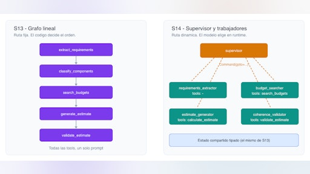

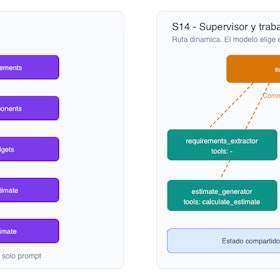

[📄 Cuándo un sistema multi-agente deja de ser "un grafo con más nodos🔴 — 18 min

- Visibility: Visible
- Unlocking: None
- Completion: Button
- Comments: On
- Thumbnail: Default
](https://training.lidr.co/posts/ai-engineering-202604-📄-cuando-un-sistema-multi-agente-deja-de-ser-un-grafo-con-mas-nodos🔴-18-min)⏳ Tiempo estimado: 18 min Tenéis un grafo de estimación que funciona. Recibe una transcripción, extrae requisitos,...
- 

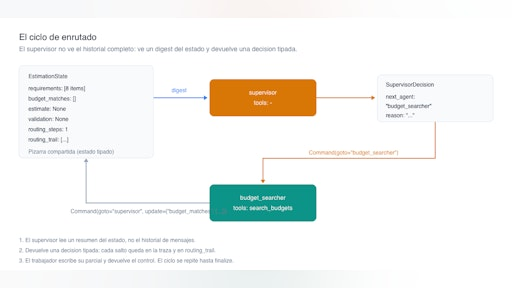

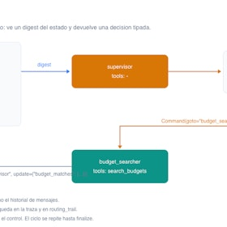

[📄El supervisor: construir el enrutado a mano con StateGraph y Command 🔴 — 19 min

- Visibility: Visible
- Unlocking: None
- Completion: Button
- Comments: On
- Thumbnail: Default
](https://training.lidr.co/posts/ai-engineering-202604-📄el-supervisor-construir-el-enrutado-a-mano-con-stategraph-y-command-🔴-19-min)⏳ Tiempo estimado: 19 min En el grafo de estimación que ya tenéis, hay una pregunta que nunca se hace en tiempo de...
- 

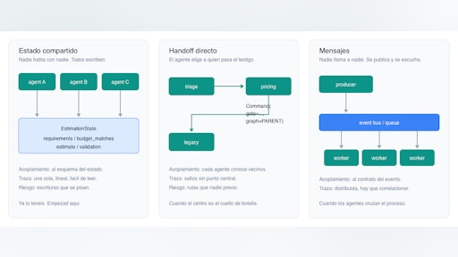

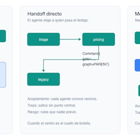

[📄Patrones de comunicación entre agentes: estado compartido, handoff y mensajes 🔴 — 17 min

- Visibility: Visible
- Unlocking: None
- Completion: Button
- Comments: On
- Thumbnail: Default
](https://training.lidr.co/posts/ai-engineering-202604-📄patrones-de-comunicacion-entre-agentes-estado-compartido-handoff-y-mensajes-🔴-17-min)⏳ Tiempo estimado: 17 min Hay una decisión en vuestra arquitectura multi-agente que probablemente no recordáis haber...
- 

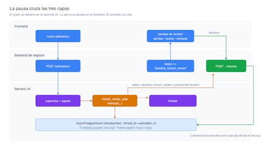

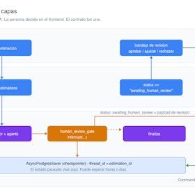

[📄Human-in-the-loop: interrupt, pausa y reanudación sobre el checkpointer🔴 — 18 min

- Visibility: Visible
- Unlocking: None
- Completion: Button
- Comments: On
- Thumbnail: Default
](https://training.lidr.co/posts/ai-engineering-202604-📄human-in-the-loop-interrupt-pausa-y-reanudacion-sobre-el-checkpointer🔴-18-min)⏳ Tiempo estimado: 18 min Vuestro sistema de estimación acaba de producir 840 horas para un CRUD de tres entidades....
- 

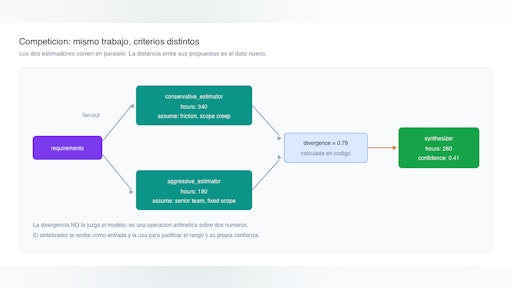

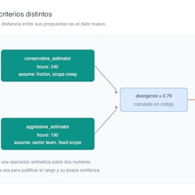

[📄Competición y síntesis entre agentes 🔴 — 18 min

- Visibility: Visible
- Unlocking: None
- Completion: Button
- Comments: On
- Thumbnail: Default
](https://training.lidr.co/posts/ai-engineering-202604-📄competicion-y-sintesis-entre-agentes-🔴-18-min)⏳ Tiempo estimado: 18 min Vuestro sistema devuelve 260 horas. ¿Cuánto os fiáis de ese número? No tenéis forma de...
- 

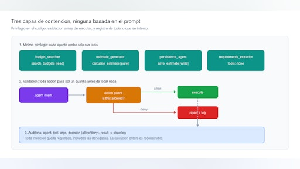

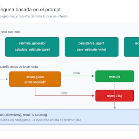

[📄Mínimo privilegio, validación de acciones y auditoría de agentes 🔴 — 19 min

- Visibility: Visible
- Unlocking: None
- Completion: Button
- Comments: On
- Thumbnail: Default
](https://training.lidr.co/posts/ai-engineering-202604-📄minimo-privilegio-validacion-de-acciones-y-auditoria-de-agentes-🔴-19-min)⏳ Tiempo estimado: 19 min Hasta ahora vuestros agentes leen. El buscador consulta presupuestos, el generador calcula,...
- 

[🆙 Evalúa el contenido de este Módulo

- Visibility: Visible
- Unlocking: None
- Completion: None
- Comments: On
- Thumbnail: Default
](https://training.lidr.co/posts/ai-engineering-202604-🆙-evalua-el-contenido-de-este-modulo-98724381)Evalúa del 1 al 5 el valor aportado por el contenido del módulo actual. Si al enviar la encuesta te aparece algún...
