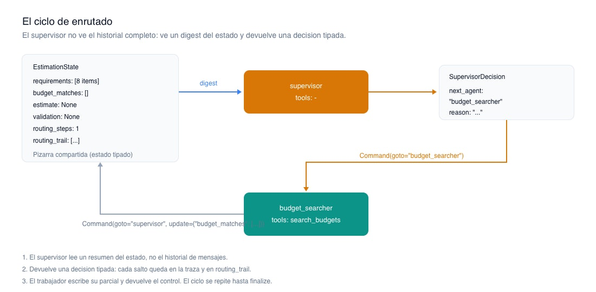
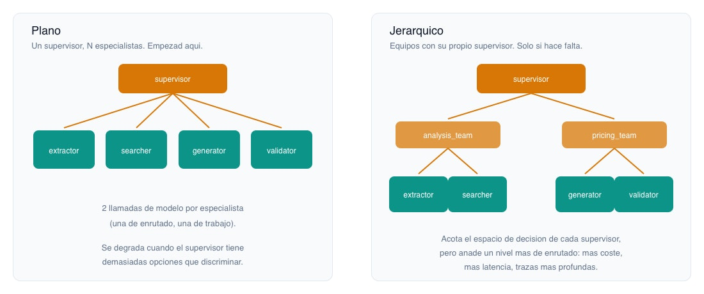

# 📄El supervisor: construir el enrutado a mano con StateGraph y Command 🔴 — 19 min

[Antonio Perez](https://training.lidr.co/members/36030888)

⏳Tiempo estimado: 19 min

En el grafo de estimación que ya tenéis, hay una pregunta que nunca se hace en tiempo de ejecución:*¿qué toca ahora?*No se hace porque la respuesta está escrita en el código. Después de extraer requisitos van los componentes, después los presupuestos, después la estimación. El orden es una propiedad del fichero, no una decisión.

Un supervisor es el componente que convierte esa pregunta en algo que ocurre en runtime. Recibe el estado actual, decide qué especialista actúa a continuación, y lo hace una y otra vez hasta que el trabajo está terminado. Es el corazón de la arquitectura, y también el sitio donde más fácil es hacerse daño: un enrutador opaco convierte todo el sistema en una caja negra.

Por eso lo vamos a construir a mano. No porque no existan abstracciones —existen, y las veremos— sino porque el enrutado es precisamente la parte que**no**queréis delegar en una capa que no controláis.

## Qué hace exactamente un supervisor

Tres cosas, y conviene separarlas porque en la literatura se mezclan:

1. 

**Descomponer**: mirar la tarea y entender qué piezas de trabajo faltan.

1. 

**Delegar**: elegir al especialista que produce la siguiente pieza y darle el control.

1. 

**Consolidar**: cuando ya no falta nada, cerrar y producir el resultado.

Lo que*no*hace, si está bien diseñado: trabajo de dominio. El supervisor no estima horas, no lee presupuestos, no valida coherencia. Si tiene tools de negocio en la mano, dejad de llamarlo supervisor: es un agente más que además enruta, y habréis reintroducido el nodo sobrecargado que queríais eliminar.

En nuestra estimación, el supervisor es un nodo sin ninguna tool. Su única salida es una decisión.

### El estado, y el digest

Lo primero que hay que decidir no es cómo enruta, sino**qué ve para enrutar**.

La tentación es pasarle el historial completo de mensajes de todos los agentes. Es lo que hacen por defecto varias abstracciones del ecosistema, y es una mala idea en cuanto el flujo tiene más de dos saltos: el contexto crece sin control, el coste por decisión sube en cada iteración, y la señal relevante queda enterrada bajo transcripciones intermedias que al supervisor no le importan.

El supervisor no necesita saber*qué dijo*el buscador de presupuestos. Necesita saber**si ya buscó**.

Eso es un*digest*: una proyección compacta del estado, construida por vosotros, que responde a la única pregunta que el supervisor tiene que resolver.
from typing import Annotated, Literal import operator from typing_extensions import TypedDict class EstimationState(TypedDict): transcript: str requirements: list[str] budget_matches: Annotated[list[dict], operator.add] estimate: dict | None validation: dict | None confidence: float | None routing_steps: int routing_trail: Annotated[list[dict], operator.add] status: str def build_state_digest(state: EstimationState) -> str: """Compact projection of the state. This is all the supervisor gets to see.""" return ( f"requirements_extracted: {len(state['requirements'])} items\n" f"budget_matches_found: {len(state['budget_matches'])}\n" f"estimate_produced: {state['estimate'] is not None}\n" f"validation_done: {state['validation'] is not None}\n" f"routing_steps_so_far: {state['routing_steps']}" )

Cinco líneas. Coste constante por decisión, independientemente de lo larga que sea la transcripción o de cuántas iteraciones lleve el flujo. Si más adelante el supervisor necesita más información para decidir bien, la añadís al digest de forma explícita y sabéis exactamente lo que estáis pagando.

Los dos camposrouting_stepsyrouting_trailno son decorativos. El primero es el freno; el segundo, la memoria de lo que hizo. Ahora veremos por qué ambos son obligatorios.

## El enrutado como decisión tipada

Un supervisor cuyo output es texto libre es un bug esperando a ocurrir. Necesitáis que la decisión sea un valor de un conjunto cerrado, validado, y que rompa ruidosamente si el modelo se sale del guion.
from pydantic import BaseModel, Field AgentName = Literal[ "requirements_extractor", "budget_searcher", "estimate_generator", "coherence_validator", "finalize", ] class SupervisorDecision(BaseModel): next_agent: AgentName = Field(description="The specialist that must act next.") reason: str = Field(description="Why this specialist, in one sentence.")

El camporeasonno lo lee ningún componente del sistema. Lo leéis vosotros, en la traza, a las tres de la mañana, cuando el supervisor haya enrutado afinalizesin haber estimado nada y necesitéis entender qué creía estar haciendo. Es barato y os va a salvar más de una vez.

Con eso, el nodo:
import logfire from langgraph.types import Command MAX_ROUTING_STEPS = 12 SUPERVISOR_INSTRUCTIONS = """You coordinate a software estimation pipeline. Given the current progress digest, choose the single specialist that must act next. Rules: - Requirements must be extracted before budgets are searched. - Budgets must be searched before an estimate is produced. - An estimate must exist before it can be validated. - Choose "finalize" only when the estimate has been produced and validated. Never choose a specialist whose work is already done. """ async def supervisor(state: EstimationState) -> Command[AgentName]: with logfire.span("supervisor.route") as span: if state["routing_steps"] >= MAX_ROUTING_STEPS: span.set_attribute("routing_budget_exhausted", True) return Command( goto="finalize", update={"status": "routing_budget_exhausted"}, ) response = await client.responses.parse( model="gpt-5", input=[ {"role": "system", "content": SUPERVISOR_INSTRUCTIONS}, {"role": "user", "content": build_state_digest(state)}, ], text_format=SupervisorDecision, ) decision = response.output_parsed span.set_attribute("next_agent", decision.next_agent) span.set_attribute("reason", decision.reason) return Command( goto=decision.next_agent, update={ "routing_steps": state["routing_steps"] + 1, "routing_trail": [decision.model_dump()], }, )

Tres detalles que merecen atención.

Command**hace dos cosas a la vez.**Actualiza el estado (update) y mueve el control (goto). Es lo que os permite que el enrutado sea una decisión del nodo y no una arista condicional declarada fuera. El tipo de retornoCommand[AgentName]no es cosmético: LangGraph lo usa para inferir los destinos posibles al construir el grafo, así que el conjunto de destinos y el conjunto de valores que el modelo puede devolver**son literalmente el mismo**Literal. Un destino nuevo sin actualizar elLiteralno compila mentalmente ni funciona en runtime.

**El presupuesto de enrutado es innegociable.**MAX_ROUTING_STEPSes lo único que impide que un supervisor confundido rebote entre dos agentes hasta agotar vuestra cuenta de OpenAI. Un bucle infinito en un grafo determinista es un bug evidente; en un grafo enrutado por un modelo es el comportamiento por defecto ante una instrucción ambigua. Ponedle un techo desde la primera línea, no después del primer susto.

**El span lleva la decisión, no la respuesta.**next_agentyreasoncomo atributos del span significan que vuestra traza es un registro navegable de cada bifurcación que tomó el sistema. Esto es exactamente lo que se pierde cuando el enrutado ocurre dentro de una abstracción de librería, y es la razón principal para construirlo a mano.

### Los trabajadores devuelven el control

Cada especialista hace su trabajo, escribe su parcial en el estado y devuelve el testigo al supervisor. Nada más.
async def budget_searcher(state: EstimationState) -> Command[Literal["supervisor"]]: with logfire.span("agent.budget_searcher"): matches = await search_budgets(requirements=state["requirements"]) return Command( goto="supervisor", update={"budget_matches": matches}, )

Fijaos en el reducer.budget_matchesestá anotado conoperator.add, así que este agente**acumula**en lugar de sobrescribir. Si el supervisor decide invocarlo dos veces con distintos requisitos —cosa que puede hacer, porque la ruta es suya— los resultados se suman en vez de pisarse. La semántica de acumulación es una decisión de diseño del estado, no un accidente.

### Montar el grafo
from langgraph.graph import StateGraph, START builder = StateGraph(EstimationState) builder.add_node("supervisor", supervisor) builder.add_node("requirements_extractor", requirements_extractor) builder.add_node("budget_searcher", budget_searcher) builder.add_node("estimate_generator", estimate_generator) builder.add_node("coherence_validator", coherence_validator) builder.add_node("finalize", finalize) builder.add_edge(START, "supervisor") graph = builder.compile(checkpointer=checkpointer)

Una sola arista declarada. Todas las demás transiciones viven dentro de los nodos, en losCommand. Esto es intencionado: el grafo ya no describe un flujo, describe**un conjunto de capacidades y un enrutador**. La forma del recorrido emerge en ejecución.

Y el checkpointer es el mismo de siempre, sobre el mismo Postgres. No hay infraestructura nueva. Esto importa más de lo que parece: cada estado intermedio del ciclo de enrutado queda persistido, lo que significa que una ejecución puede pararse, inspeccionarse y reanudarse en cualquiera de sus saltos.

## Trade-offs, y una alternativa que a menudo gana

### El impuesto de enrutado

Cada decisión del supervisor es una llamada al modelo que no produce ni una hora de estimación. En una topología plana, una tarea que toque cuatro especialistas cuesta**ocho**llamadas: cuatro de trabajo y cuatro de enrutado. El grafo lineal hacía cuatro. Estáis pagando el 100% de sobrecoste por la flexibilidad de que la ruta se decida sola.

Ese impuesto se justifica si la ruta*de verdad*varía. Si en el 95% de las transcripciones el supervisor acaba eligiendo la misma secuencia, estáis pagando un modelo para que reinvente unforcada vez.

### El supervisor híbrido: la opción aburrida que suele ser correcta

Aquí va una postura que va contra la corriente del ecosistema:**la mayoría de las decisiones de enrutado no necesitan un LLM**. Que los requisitos deban extraerse antes de buscar presupuestos no es un juicio matizado; es una precondición. Codificarla como una instrucción en un*system prompt*y rezar para que el modelo la respete es cambiar una garantía por una probabilidad, y encima pagando.

El patrón que os va a servir en producción es un enrutador que resuelve por reglas lo que es determinista y**solo llama al modelo cuando hay ambigüedad real**:
async def supervisor(state: EstimationState) -> Command[AgentName]: if state["routing_steps"] >= MAX_ROUTING_STEPS: return Command(goto="finalize", update={"status": "routing_budget_exhausted"}) # Deterministic preconditions: no model call needed, no way to get them wrong. if not state["requirements"]: return Command(goto="requirements_extractor", update=_bump(state)) if not state["budget_matches"]: return Command(goto="budget_searcher", update=_bump(state)) # Genuine ambiguity: the estimate exists but validation flagged concerns. # Re-estimate with more context, search for further analogues, or accept? # This is a judgement call. Here the model earns its keep. return await route_with_model(state)

El resultado es un sistema más barato, más rápido, más predecible y más fácil de testear, que**conserva la inteligencia exactamente donde aporta**. Y tiene una virtud pedagógica: os obliga a nombrar cuáles son las decisiones difíciles de vuestro dominio. Si al escribir esto descubrís que no hay ninguna ambigüedad real —que todas las bifurcaciones son precondiciones— habéis descubierto algo importante: no necesitáis un supervisor con modelo. Necesitáis el grafo que ya teníais.

### No-determinismo y testing

Cuando la ruta la decide un modelo, dos ejecuciones sobre la misma transcripción pueden recorrer caminos distintos. Consecuencia práctica:**no testeéis el camino, testead el resultado y las invariantes**. Que se haya producido una estimación. Que ningún agente actuara sin sus precondiciones. Querouting_stepsno superara el techo. Elrouting_trailos da todo eso en un campo del estado, inspeccionable desde un test sin necesidad de instrumentación adicional.

## Panorámica: plano, jerárquico, y las abstracciones

**Plano vs jerárquico.**Con cuatro especialistas, un supervisor plano va sobrado. El problema aparece con quince: el enrutador tiene que discriminar entre quince opciones en cada decisión y su precisión se degrada, exactamente igual que la de un agente con quince tools. La respuesta entonces es agrupar por equipos, con un supervisor de nivel superior que enruta a equipos y sub-supervisores que enrutan dentro. Es la misma jerarquía de una organización, y por el mismo motivo.

El coste es real: un nivel más de jerarquía es una llamada más de enrutado por salto y una traza más profunda de leer. No empecéis aquí. Llegad aquí cuando el supervisor plano os empiece a fallar.

**Las abstracciones del ecosistema.**Existen librerías que montan esta topología por vosotros —create_supervisory compañía. Merece la pena saber que existen y saber esto otro: la propia recomendación actual de LangChain para la mayoría de casos es**implementar el patrón supervisor directamente**, con tools yCommand, en lugar de usar la abstracción, precisamente porque así se conserva el control sobre qué contexto recibe cada agente y cada decisión de enrutado queda visible en las trazas.

No es una anécdota de ecosistema. Es la confirmación de algo que ya sabíais aplicar en cualquier otro dominio: la abstracción que os oculta la decisión que necesitáis inspeccionar no os está ahorrando trabajo, os lo está aplazando. Aquí la decisión que necesitáis inspeccionar es exactamente el enrutado, así que la abstracción que lo oculta es la que no os sirve.

## Lo que el supervisor todavía no resuelve

Con esto tenéis una arquitectura que enruta y consolida, con cada bifurcación registrada y con un freno que impide que se desboque.

Pero hemos dado por hecha una decisión grande sin discutirla: los agentes se comunican**escribiendo en un estado compartido**. Ninguno le habla a otro directamente. Es una elección, no la única, y tiene consecuencias en el coste, en el acoplamiento y en cuánto contexto arrastra el sistema. Hay topologías donde el testigo pasa de agente a agente sin volver al centro, y las hay donde la comunicación es un flujo de eventos que nadie orquesta.

Cuál os conviene depende de dónde esté el cuello de botella. Y esa es la siguiente conversación.
