# Sesión 15. Puesta en producción de proyectos, arquitectura e infra — 77 min
[

2 Mentors](https://training.lidr.co/posts/ai-engineering-202604-sesion-15-puesta-en-produccion-de-proyectos-arquitectura-e-infra-77-min/instructors)

⏳Tiempo estimado: 1 min

[Video](https://player.vimeo.com/video/1200715792?h=d4075ef446)

Tu RAG ya funciona: recupera presupuestos parecidos a lo que buscas. Pero parecido no es lo mismo que útil, y cuando el sistema te devuelve una app de pagos al pedirle una plataforma de e-commerce, estás a un paso de una mala estimación. En esta sesión convertimos una recuperación aceptable en una recuperación precisa — y lo demostramos con números, no con sensaciones.

**En esta sesión descubrirás:**

→ Por qué la búsqueda vectorial ordena mal los resultados finos y cómo el reranking con cross-encoders reordena los candidatos leyendo consulta y documento juntos

→ Cómo combinar búsqueda semántica y búsqueda por palabras exactas con full-text search en PostgreSQL, y cómo fusionar ambos rankings con Reciprocal Rank Fusion

→ Cómo medir con un golden set propio si cada técnica compensa su coste en latencia, antes de llevarla a producción

→ Cómo descomponer consultas complejas en sub-búsquedas y dirigir cada una al índice correcto mediante routing

→ Cómo el filtrado por metadatos y el decaimiento temporal evitan que un presupuesto obsoleto contamine tus estimaciones

Para finalizar, añade tu opinión sobre el contenido y el ejercicio de este módulo:
🆙Evalúa el contenido y el ejercicio de este Módulo

### 
❗Obtén los recursos completos en las siguientes lecciones👇

- 

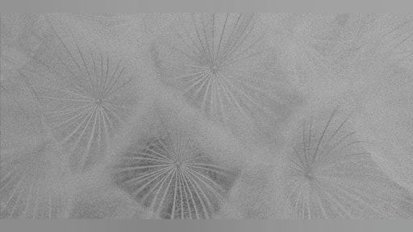

[✍️Dockerización del proyecto 🔴

- Visibility: Visible
- Unlocking: None
- Completion: Button
- Comments: On
- Thumbnail: Default
](https://training.lidr.co/posts/ai-engineering-202604-✍️dockerizacion-del-proyecto-🔴)⏳ Tiempo estimado: 5 min 🚨 La fecha límite: lunes 17 de agosto a las 23:59 de tu hora local. Contexto Hasta ahora has...
- 

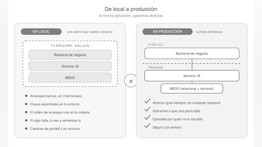

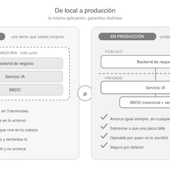

[📄 Que entendemos por producción 🔴 — 14 min

- Visibility: Visible
- Unlocking: None
- Completion: Button
- Comments: On
- Thumbnail: Default
](https://training.lidr.co/posts/ai-engineering-202604-📄-que-entendemos-por-produccion-🔴-14-min)⏳ Tiempo estimado: 14 min Al terminar el módulo anterior tenéis un sistema de estimación que funciona. Recibe una...
- 

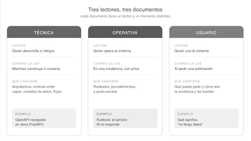

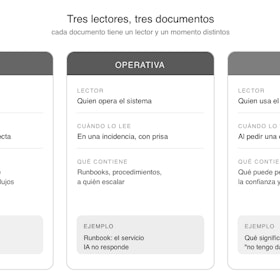

[📄 Documentar el sistema 🔴 — 14 min

- Visibility: Visible
- Unlocking: None
- Completion: Button
- Comments: On
- Thumbnail: Default
](https://training.lidr.co/posts/ai-engineering-202604-📄-documentar-el-sistema-🔴-14-min)⏳ Tiempo estimado: 14 min Acabáis de conseguir que el sistema de estimación arranque con un comando. docker compose...
- 

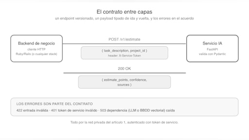

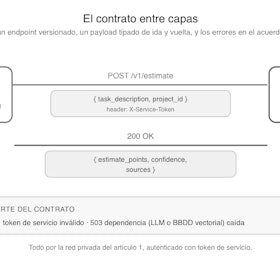

[📄 Partir en servicios 🔴 — 13 min

- Visibility: Visible
- Unlocking: None
- Completion: Button
- Comments: On
- Thumbnail: Default
](https://training.lidr.co/posts/ai-engineering-202604-📄-partir-en-servicios-🔴-13-min)⏳ Tiempo estimado: 13 min Mirad la implementación de referencia un momento, porque toma una decisión que, vista de...
- 

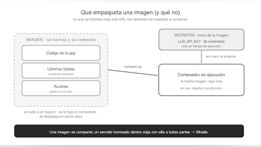

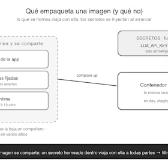

[📄 Contenerización con Docker 🔴 — 12 min

- Visibility: Visible
- Unlocking: None
- Completion: Button
- Comments: On
- Thumbnail: Default
](https://training.lidr.co/posts/ai-engineering-202604-📄-contenerizacion-con-docker-🔴-12-min)⏳ Tiempo estimado: 12 min La frase se dice siempre con el mismo tono: a la defensiva. Un compañero se baja vuestro...
- 

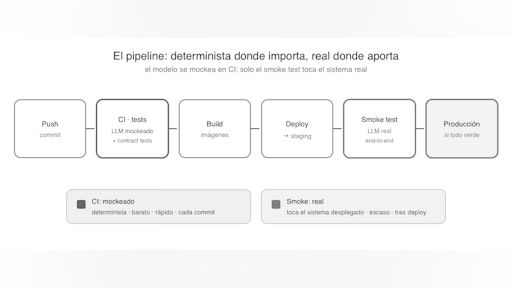

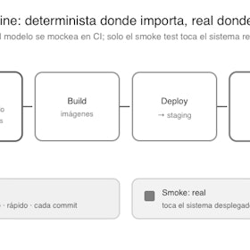

[📄 CI/CD con tokens 🔴 — 12 min

- Visibility: Visible
- Unlocking: None
- Completion: Button
- Comments: On
- Thumbnail: Default
](https://training.lidr.co/posts/ai-engineering-202604-📄-cicd-con-tokens-🔴-12-min)⏳ Tiempo estimado: 12 min Tenéis las imágenes del artículo anterior: cada servicio empaquetado, reproducible,...
- 

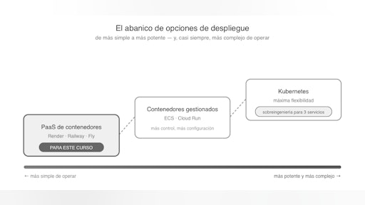

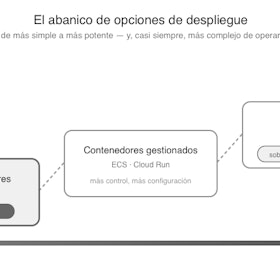

[📄Despliegue en Clouds 🔴 — 12 min

- Visibility: Visible
- Unlocking: None
- Completion: Button
- Comments: On
- Thumbnail: Default
](https://training.lidr.co/posts/ai-engineering-202604-📄despliegue-en-clouds-🔴-12-min)⏳ Tiempo estimado: 12 min Durante toda la sesión hemos usado la palabra "desplegar" sin abrirla. El pipeline del...
- 

[🆙 Evalúa el contenido de este Módulo

- Visibility: Visible
- Unlocking: None
- Completion: None
- Comments: On
- Thumbnail: Default
](https://training.lidr.co/posts/ai-engineering-202604-🆙-evalua-el-contenido-de-este-modulo-98724399)Evalúa del 1 al 5 el valor aportado por el contenido del módulo actual. Si al enviar la encuesta te aparece algún...
Explore More Posts[Previous📼 Grabación de sesión 16](https://training.lidr.co/posts/ai-engineering-202604-📼-grabacion-de-sesion-16)[Next✍️Dockerización del proyecto 🔴](https://training.lidr.co/posts/ai-engineering-202604-✍️dockerizacion-del-proyecto-🔴)
