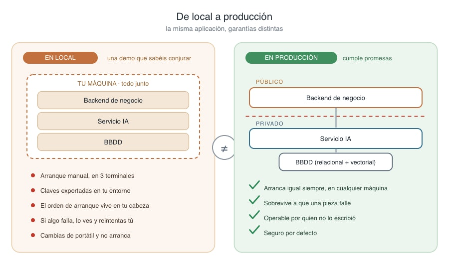
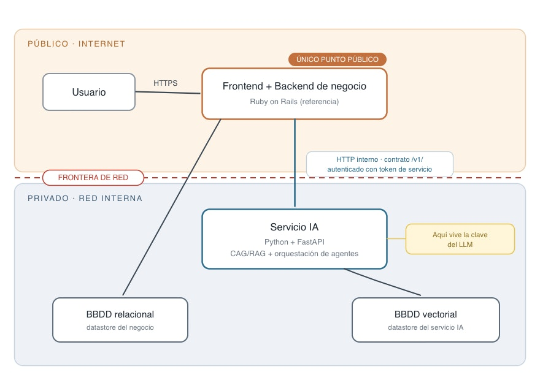

# 📄 Que entendemos por producción 🔴 — 14 min

⏳Tiempo estimado: 14 min

Al terminar el módulo anterior tenéis un sistema de estimación que funciona. Recibe una transcripción, extrae requisitos, recupera presupuestos históricos de la base de datos vectorial, orquesta a sus agentes y devuelve una estimación con su nivel de confianza y sus fuentes. Y funciona de verdad: lo habéis visto responder decenas de veces en vuestra máquina.

El problema es que "en vuestra máquina" es exactamente la parte que hay que quitar.

Ahora mismo, para que el sistema arranque, hacéis un ritual: una terminal para levantar el backend de negocio, otra para el servicio IA, la base de datos vectorial corriendo por su cuenta, las claves exportadas en vuestro.bashrc, y un orden de arranque que solo vive en vuestra cabeza. Si mañana os cambian el portátil, o entra alguien nuevo al equipo, o simplemente reiniciáis y no recordáis qué iba primero, el sistema no arranca. Eso no es un sistema en producción. Es una demo que sabéis conjurar.

Este artículo trata de esa frontera. De qué separa "funciona en local" de "está en producción", que resulta no ser un servidor en algún sitio, sino un conjunto de garantías que hasta ahora no habéis tenido que dar.

## "Producción" no es un lugar, es una promesa

La intuición habitual es que producción es un sitio: un servidor en la nube en vez de vuestro portátil. Es una forma pobre de entenderlo, porque os hace pensar que el trabajo es "subir" el sistema, como quien copia una carpeta. Y no.

Producción es el estado en el que el sistema tiene que cumplir cosas que en local nadie os exigía:

Tiene que**arrancar igual siempre**, en cualquier máquina, sin vuestro conocimiento tribal. Si el arranque depende de que alguien recuerde un paso, ese paso es una bomba de relojería.

Tiene que**sobrevivir a que una pieza falle**sin caerse entero. En local, si el proveedor de LLM da un error, lo veis en la terminal y lo reintentáis a mano. En producción no hay nadie mirando la terminal: el sistema tiene que degradar con criterio, no reventar.

Tiene que**ser operable por alguien que no lo escribió**. Cuando a las tres de la madrugada el sistema deje de estimar, quien esté de guardia —que puede no ser ninguno de vosotros— necesita saber qué mirar y qué tocar sin ingeniería inversa.

Y tiene que**ser seguro por defecto**, porque en el momento en que el sistema es alcanzable desde fuera, deja de estar en un entorno de confianza. En vuestra máquina, todo el que llega a los servicios sois vosotros. En producción, no.

*Diagrama 2: la misma aplicación en local y en producción no es el mismo sistema en dos sitios, sino dos sistemas con exigencias distintas.*

Fijaos en que ninguna de esas cuatro promesas es "estar en la nube". Se pueden romper las cuatro en la nube y se pueden cumplir las cuatro en un servidor bajo vuestra mesa. Producción es el conjunto de promesas, no la dirección IP.

## La decisión que lo cambia todo: qué mira a la calle

De todas esas promesas hay una que reordena la arquitectura entera, y conviene fijarla antes que ninguna otra:**qué pieza del sistema es alcanzable desde internet y cuál no.**

En local esta pregunta no existe porque la respuesta es "ninguna, todo está enlocalhost". En producción es la primera decisión de diseño, y tiene una respuesta que no es negociable para nuestro sistema:**el servicio IA no mira a la calle. Nunca.**

La razón es concreta, no dogmática. El servicio IA es quien custodia la clave del proveedor de LLM. Exponerlo a internet es exponer vuestra factura a que cualquiera que descubra la URL la gaste por vosotros, tokens ajenos contra vuestra tarjeta, hasta que os deis cuenta. Y hay una segunda razón igual de seria: las reglas de negocio —quién puede pedir una estimación, cuántas al día, con qué límites— viven en el backend de negocio. Si el servicio IA fuese público, cualquiera podría saltárselas hablándole directamente, por debajo de toda vuestra lógica de permisos.

Así que la topología de producción se organiza alrededor de una frontera. Fuera de ella, mirando a internet, solo está el backend de negocio (con el frontend), que es quien recibe al usuario por HTTPS y quien aplica las reglas. Dentro, en una red privada a la que no se llega desde fuera, está el servicio IA y están las bases de datos. El backend de negocio cruza esa frontera hacia dentro para pedirle estimaciones al servicio IA, por HTTP interno y autenticado con un token de servicio; nadie más la cruza.

*Diagrama 1: la frontera público/privado. Solo el backend de negocio mira a internet; el servicio IA, la clave del LLM y las bases de datos viven en la red privada.*

Si interiorizáis solo una cosa de este artículo, que sea esta frontera. Todo lo que viene después en la sesión —cómo empaquetáis cada pieza, cómo las desplegáis, cómo las conectáis— es, en buena medida, la mecánica de construir y respetar esa línea.

## Tres capas que ahora se despliegan solas

Hay una consecuencia inmediata de tomarse en serio la frontera, y es que las tres capas del programa dejan de ser una separación conceptual para convertirse en**tres unidades que se despliegan y se escalan por separado**.

Recordad el reparto: el frontend y el backend de negocio (en la implementación de referencia, un único proyecto Ruby on Rails) gestionan usuarios, sesiones, persistencia y reglas de negocio; el servicio IA, siempre en Python con FastAPI, encapsula la llamada al LLM, la lógica RAG y la orquestación de agentes. Cada uno respaldado por su almacén: la base de datos relacional para el negocio, la base de datos vectorial para el servicio IA.

En local esa separación era casi estética: tres procesos en tres terminales. En producción se vuelve estructural, porque las tres piezas tienen necesidades distintas. El servicio IA consume mucho y tarda segundos por petición; el backend de negocio atiende un CRUD barato e instantáneo. Separados, podéis escalar el que sufre sin tocar el otro, actualizar un prompt del servicio IA sin volver a desplegar toda la aplicación, y que cada uno viva en el lenguaje que le corresponde. Es el mismo argumento de siempre —responsabilidades distintas, componentes distintos— pero ahora con una consecuencia operativa: cada capa es un artefacto que se construye, se versiona y se despliega por su cuenta.

Una advertencia para no pasarse de frenada: "que se desplieguen solas" no significa fragmentar en veinte microservicios. Son las tres capas, más sus datastores. Ni una pieza más de la que el sistema pida a gritos. La complejidad operativa que añade cada servicio nuevo se paga entera; solo la añadís cuando compra algo.

## El resto de la sesión, en un mapa

Con la frontera clara y las tres capas entendidas como unidades desplegables, el resto de la sesión es el camino que lleva vuestro sistema de local a esa topología, y cada artículo es un tramo:

Primero,**documentarlo**, porque un sistema que solo sabéis operar vosotros todavía no cumple la promesa de ser operable por otros. Después,**entender por qué se parte en servicios y cómo hablan entre sí**: el contrato entre el backend de negocio y el servicio IA es la frontera hecha código, y hay que diseñarlo con cuidado. Luego,**empaquetar cada pieza en un contenedor**, para que "arranca igual siempre" deje de ser un deseo y sea una propiedad. A continuación,**montar el pipeline y los entornos**, con una regla que sorprende a casi todo el mundo: en integración continua, lo último que queréis es llamar al modelo de verdad. Y por último,**desplegar en cloud**, que a estas alturas será sobre todo aplicar la frontera público/privado sobre infraestructura real.

## Lo que queda por decidir

Si os habéis quedado con la sensación de que "poner en producción" se parece sospechosamente a cosas que ya sabéis hacer —reproducibilidad, separación de responsabilidades, no dejar secretos a la vista, pensar en quién puede llamar a qué— es que lo habéis entendido. No hay un paradigma nuevo. Hay un cambio de exigencia: las mismas buenas prácticas que en local eran opcionales, en producción son la diferencia entre un sistema y una demo frágil.

Pero decidir*que*hay que cumplir esas promesas es la parte fácil. Lo que queda abierto es más concreto y más incómodo:

Alguien tendrá que**documentar**el sistema de forma que sobreviva a que os vayáis, sin convertirlo en un tocho que nadie lee ni mantiene. Habrá que**fijar el contrato**entre las capas de manera que se pueda cambiar una sin romper la otra. Cada pieza tendrá que**empaquetarse**sin que un solo secreto acabe horneado dentro de una imagen que luego se comparte. El pipeline tendrá que**testear el sistema sin gastar un token ni depender de la no-determinación del modelo**. Y el despliegue tendrá que**materializar la frontera**en redes de verdad, donde equivocarse tiene consecuencias que se pagan.

Esas cinco decisiones —documentación, contrato, empaquetado, pipeline y frontera— son el resto del camino.
Explore More PostsThis Lesson is complete.[Previous✍️Dockerización del proyecto 🔴](https://training.lidr.co/posts/ai-engineering-202604-✍️dockerizacion-del-proyecto-🔴)[Next📄 Documentar el sistema 🔴 — 14 min](https://training.lidr.co/posts/ai-engineering-202604-📄-documentar-el-sistema-🔴-14-min)
