# Sesión 16. Puesta en producción II - Calidad y observabilidad — 77 min
[

2 Mentors](https://training.lidr.co/posts/ai-engineering-202604-sesion-16-puesta-en-produccion-ii-calidad-y-observabilidad-77-min/instructors)

⏳Tiempo estimado: 2 min

[Video](https://player.vimeo.com/video/1200715792?h=d4075ef446)

Tu RAG ya funciona: recupera presupuestos parecidos a lo que buscas. Pero parecido no es lo mismo que útil, y cuando el sistema te devuelve una app de pagos al pedirle una plataforma de e-commerce, estás a un paso de una mala estimación. En esta sesión convertimos una recuperación aceptable en una recuperación precisa — y lo demostramos con números, no con sensaciones.

**En esta sesión descubrirás:**

→ Por qué la búsqueda vectorial ordena mal los resultados finos y cómo el reranking con cross-encoders reordena los candidatos leyendo consulta y documento juntos

→ Cómo combinar búsqueda semántica y búsqueda por palabras exactas con full-text search en PostgreSQL, y cómo fusionar ambos rankings con Reciprocal Rank Fusion

→ Cómo medir con un golden set propio si cada técnica compensa su coste en latencia, antes de llevarla a producción

→ Cómo descomponer consultas complejas en sub-búsquedas y dirigir cada una al índice correcto mediante routing

→ Cómo el filtrado por metadatos y el decaimiento temporal evitan que un presupuesto obsoleto contamine tus estimaciones

Para finalizar, añade tu opinión sobre el contenido y el ejercicio de este módulo:
🆙Evalúa el contenido y el ejercicio de este Módulo

### 
❗Obtén los recursos completos en las siguientes lecciones👇

- 

[✍️Golden set de producción 🔴

- Visibility: Visible
- Unlocking: None
- Completion: Button
- Comments: On
- Thumbnail: Default
](https://training.lidr.co/posts/ai-engineering-202604-✍️golden-set-de-produccion-🔴)⏳ Tiempo estimado: 5 min 🚨 La fecha límite: martes 25 de agosto a las 23:59 de tu hora local Contexto Tras la Sesión...
- 

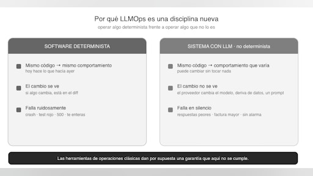

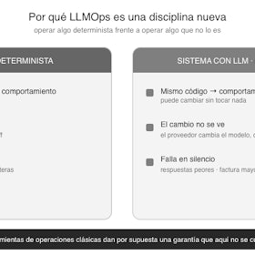

[📄 Introducción LLMOps 🔴 — 11 min

- Visibility: Visible
- Unlocking: None
- Completion: Button
- Comments: On
- Thumbnail: Default
](https://training.lidr.co/posts/ai-engineering-202604-📄-introduccion-llmops-🔴-11-min)⏳ Tiempo estimado: 11 min Cerrasteis la sesión anterior con una pequeña victoria legítima: el sistema de estimación...
- 

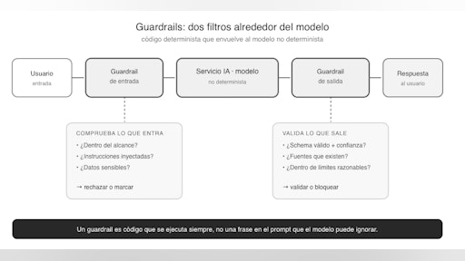

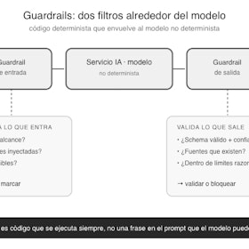

[📄 Un sistema debe saber decir “No lo sé” 🔴 — 14 min

- Visibility: Visible
- Unlocking: None
- Completion: Button
- Comments: On
- Thumbnail: Default
](https://training.lidr.co/posts/ai-engineering-202604-📄-un-sistema-debe-saber-decir-no-lo-se-🔴-14-min)⏳ Tiempo estimado: 14 min Imaginad una petición cualquiera de las que le llegan a vuestro sistema en producción. Un...
- 

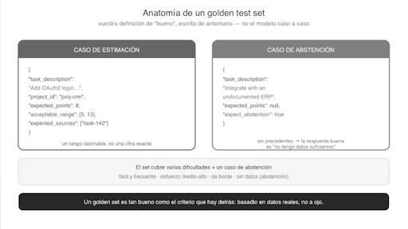

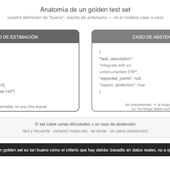

[📄 Evaluacion en producción 🔴 — 13 min

- Visibility: Visible
- Unlocking: None
- Completion: Button
- Comments: On
- Thumbnail: Default
](https://training.lidr.co/posts/ai-engineering-202604-📄-evaluacion-en-produccion-🔴-13-min)⏳ Tiempo estimado: 13 min Cambiáis una palabra en el prompt de estimación. Lanzáis tres o cuatro transcripciones de...
- 

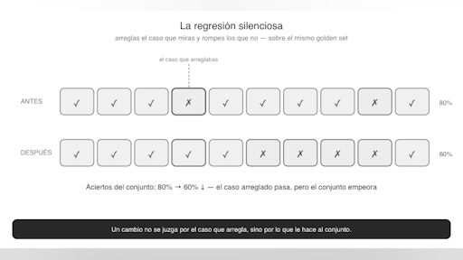

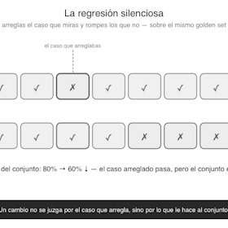

[📄 Tratamiento de regresiones 🔴 — 12 min

- Visibility: Visible
- Unlocking: None
- Completion: Button
- Comments: On
- Thumbnail: Default
](https://training.lidr.co/posts/ai-engineering-202604-📄-tratamiento-de-regresiones-🔴-12-min)⏳ Tiempo estimado: 12 min Un usuario se queja: las estimaciones para tareas de autenticación se le quedan cortas....
- 

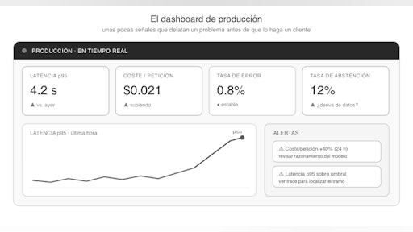

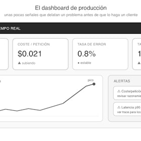

[📄 Observabilidad 🔴 — 12 min

- Visibility: Visible
- Unlocking: None
- Completion: Button
- Comments: On
- Thumbnail: Default
](https://training.lidr.co/posts/ai-engineering-202604-📄-observabilidad-🔴-12-min)⏳ Tiempo estimado: 12 min El golden set está en verde. La última evaluación fue buena, los KPIs aguantan, el...
- 

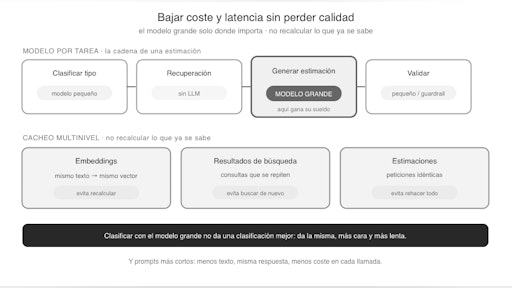

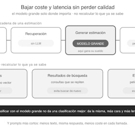

[📄Coste, latencia y A/B Testing 🔴 — 13 min

- Visibility: Visible
- Unlocking: None
- Completion: Button
- Comments: On
- Thumbnail: Default
](https://training.lidr.co/posts/ai-engineering-202604-📄coste-latencia-y-ab-testing-🔴-13-min)⏳ Tiempo estimado: 13 min La observabilidad del artículo anterior os ha puesto delante la factura y el reloj: ahora...
- 

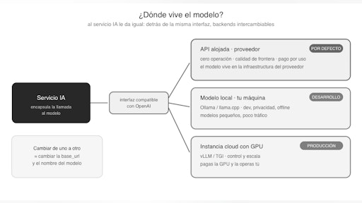

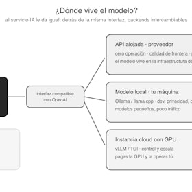

[📄Modelos en local 🔴 — 14 min

- Visibility: Visible
- Unlocking: None
- Completion: Button
- Comments: On
- Thumbnail: Default
](https://training.lidr.co/posts/ai-engineering-202604-📄modelos-en-local-🔴-14-min)⏳ Tiempo estimado: 14 min Durante toda la sesión, cuando el servicio IA ha necesitado un modelo, ha hecho lo mismo:...
- 

[🆙 Evalúa el contenido de este Módulo

- Visibility: Visible
- Unlocking: None
- Completion: None
- Comments: On
- Thumbnail: Default
](https://training.lidr.co/posts/ai-engineering-202604-🆙-evalua-el-contenido-de-este-modulo-105244643)Evalúa del 1 al 5 el valor aportado por el contenido del módulo actual. Si al enviar la encuesta te aparece algún...
Explore More Posts[Previous🆙 Evalúa el contenido de este Módulo](https://training.lidr.co/posts/ai-engineering-202604-🆙-evalua-el-contenido-de-este-modulo-98724399)[Next✍️Golden set de producción 🔴](https://training.lidr.co/posts/ai-engineering-202604-✍️golden-set-de-produccion-🔴)
