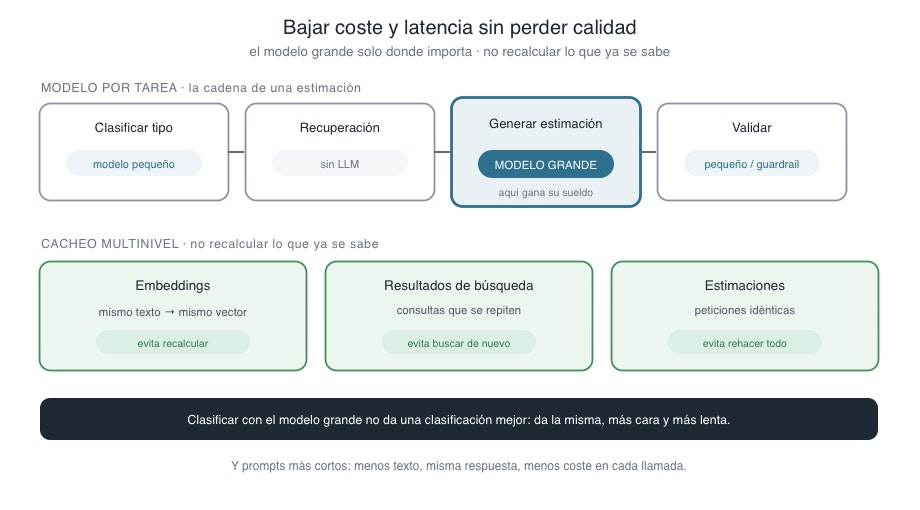
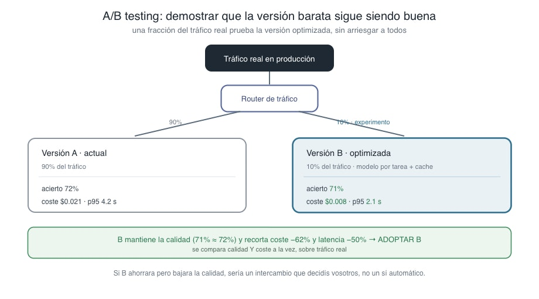

# 📄Coste, latencia y A/B Testing 🔴 — 13 min

⏳Tiempo estimado: 13 min

La observabilidad del artículo anterior os ha puesto delante la factura y el reloj: ahora veis lo que cuesta cada petición y lo que tarda cada tramo. Y una vez que se ven, hay algo que no se puede dejar de ver.

Vuestro sistema manda**todas**las peticiones al modelo más grande. La pregunta trivial —"¿de qué tipo es esta tarea, backend o frontend?"— y la pregunta difícil —"estima este proyecto sin precedentes"— van las dos al mismo modelo caro y lento. Es como poner a vuestro arquitecto más senior a contestar el teléfono y a clasificar el correo. Funciona, sí. Pero es la forma más cara imaginable de que funcione.

Este es el último tramo de la sesión: bajar el coste y la latencia sin estropear la calidad. Y trae consigo una pregunta que lo cierra todo, porque optimizar es fácil; lo difícil es demostrar que no habéis roto nada al hacerlo.

## Cada respuesta tiene un precio, y no todas valen lo mismo

El error de fondo es tratar el sistema como si hiciera una sola cosa. No la hace. Una estimación con RAG y agentes es en realidad una cadena de sub-tareas de dificultad muy distinta: clasificar el tipo de tarea, enrutar hacia la estrategia adecuada, recuperar precedentes, generar la estimación razonada, validar el resultado. Meterlas todas en el mismo saco —el del modelo grande— es ignorar que no pesan lo mismo.

Y no pesan lo mismo. Clasificar un tipo de tarea o decidir un routing son problemas fáciles, de los que un modelo pequeño y barato resuelve igual de bien que uno grande. Generar una estimación razonada a partir de precedentes ambiguos, eso sí es difícil, y ahí el modelo grande gana su sueldo. La idea —**modelo por tarea**— es tan simple como suena: el modelo caro solo donde la calidad lo exige; el barato en todo lo demás. Clasificar con el modelo grande no os da una clasificación mejor; os da la misma clasificación, más cara y más lenta.

*Diagrama: modelo por tarea y cacheo multinivel. El modelo grande se reserva para la generación —donde la calidad lo exige—; las sub-tareas fáciles van a un modelo pequeño, y el cacheo evita recalcular lo que ya se sabe.*

## No recalculéis lo que ya sabéis

La segunda fuente de coste y latencia es más tonta todavía: recalcular cosas que ya teníais. En producción, muchas entradas se repiten o se parecen, y vuestro sistema, como no se acuerda, las rehace desde cero cada vez. El**cacheo**es acordarse, y se aplica a varios niveles.

El más claro es el de**embeddings**: el embedding de un texto es determinista —el mismo texto da siempre el mismo vector—, así que calcularlo dos veces es tirar tokens y tiempo a la basura. Se cachea y listo. Por encima, se pueden cachear los**resultados de búsqueda**para consultas que se repiten, y hasta**estimaciones enteras**para peticiones idénticas. Cada nivel de caché es un trozo de trabajo que os saltáis, y ese trabajo cuesta dinero y reloj.

A esto se suma la higiene de**prompts**: un prompt inflado paga tokens de más en cada llamada, para siempre. Recortar lo que no se gana su sitio en el prompt no mejora la calidad, pero baja la factura en cada una de las millones de veces que el sistema lo usa. La optimización de tokens es de las pocas cosas que salen gratis: menos texto, misma respuesta, menos coste.

## El peligro de optimizar: abaratar rompiendo

Aquí es donde el artículo se pone serio, porque todo lo anterior suena a ganancia sin riesgo, y no lo es.**Cada optimización es una apuesta a que la calidad sobrevive.**Cambiáis la clasificación al modelo pequeño: ¿y si enruta mal un tipo de tarea y arruina la estimación entera? Recortáis el prompt: ¿y si justo cortasteis la instrucción que evitaba que alucinara las fuentes? Cacheáis estimaciones: ¿y si servís una respuesta vieja para un proyecto que cambió?

Optimizar sin medir no es optimizar: es degradar el sistema a propósito, con la esperanza de que no se note. Y "con la esperanza de que no se note" es exactamente la forma de trabajar que esta sesión entera se ha dedicado a desterrar.

La buena noticia es que ya tenéis las herramientas. Cada optimización pasa por el mismo filtro que cualquier otro cambio: lanzáis el golden set, comparáis con la línea base, y miráis si la tasa de aciertos aguantó. El regression testing del artículo 4 no distingue entre "mejoré el prompt" y "abaraté el modelo": las dos son cambios, y las dos se juzgan por lo que le hacen al conjunto. Pero hay un límite: el golden set es el laboratorio, y algunos efectos de una optimización —sobre todo con tráfico y entradas reales— solo se ven en producción.

## A/B testing: demostrar que la versión barata sigue siendo buena

Para esos efectos que el laboratorio no ve, la prueba definitiva se hace en producción, y con cuidado. No desplegáis la versión barata a todo el mundo y cruzáis los dedos. Hacéis un**A/B testing**: mandáis una fracción del tráfico real —un 10%, digamos— a la versión B (la optimizada), dejáis el resto en la versión A (la actual), y comparáis. Sobre tráfico de verdad, con usuarios de verdad, sin arriesgar a todos.

Lo importante es**qué**comparáis. No basta con mirar que B es más barata y más rápida —eso ya lo sabíais al diseñarla—; hay que mirar, a la vez, que B**mantiene la calidad**: que la tasa de aciertos no cayó, que no alucina más, que no abstiene de menos. La decisión sale de cruzar las dos cosas. Si B recorta el coste a la mitad y la calidad se queda igual, adoptáis B con evidencia, no con fe. Si B ahorra pero la calidad baja, acabáis de aprender —barato, sobre un 10% del tráfico— que esa optimización no salía a cuenta.

*Diagrama: A/B testing. Una fracción del tráfico real va a la versión B (optimizada) y el resto a la A (actual); se comparan calidad y coste a la vez, y se decide con evidencia cuál gana.*

Fijaos en que el A/B testing es la respuesta honesta a la pregunta que abría el artículo. "El modelo grande para todo es la forma más cara de acertar" sugiere que hay que abaratar; el A/B testing es lo que os permite abaratar**sabiendo**que seguís acertando, en vez de suponiéndolo. Es optimización con red.

## Cierre: de hacer funcionar una demo a operar un producto

Con esto se cierra la sesión y, con ella, el recorrido entero del proyecto. Vale la pena mirar atrás todo el camino, porque ha sido largo y coherente.

La Sesión 15 cogió un sistema que funcionaba en un portátil y lo**desplegó**: documentado, partido en las fronteras que compran algo, containerizado, con un pipeline que lo construye y lo prueba, y con la frontera público/privado sobre infraestructura real. Al final de aquella sesión el sistema estaba*vivo*. Esta sesión le ha puesto**ojos y frenos**: un suelo de seguridad para que no haga daño con su propia confianza, una vara para medir si es bueno, una red para que no se degrade sin avisar, un monitor para ver qué hace en producción, y el control de coste y latencia para que salga a cuenta. Las cuatro preguntas del mapa del primer artículo —¿es bueno?, ¿sigue siéndolo?, ¿es seguro?, ¿cuánto cuesta?— tienen ya respuesta, y la respuesta se puede medir.

El sistema de estimación no solo está en producción: está**operado**en producción. Eso es LLMOps, y es la diferencia entre tener una demo impresionante y tener un producto en el que alguien puede confiar su presupuesto.

Y fijaos en la forma que tiene todo lo que habéis aprendido en estas dos sesiones. Casi nada era magia de IA. Documentar, separar responsabilidades, no dejar secretos a la vista, testear, medir contra una referencia, vigilar señales, controlar el gasto: son disciplinas de ingeniería de toda la vida. Lo único verdaderamente nuevo fue aplicarlas a un sistema cuyo comportamiento no vive en el código y que, por tanto, hay que tratar como algo vivo. Ese cambio de mirada —de "hacer que una demo con IA funcione" a "operar un producto con IA"— es, en el fondo, lo que os llevaréis del programa.

El proyecto queda cerrado y operado. Lo que viene ahora, en el Laboratorio 10x Engineer, ya no es sobre este sistema: es sobre vosotros, y sobre cómo todo esto cambia la forma en que construís software a partir de aquí.
Explore More PostsThis Lesson is complete.[Previous📄 Observabilidad 🔴 — 12 min](https://training.lidr.co/posts/ai-engineering-202604-📄-observabilidad-🔴-12-min)[Next📄Modelos en local 🔴 — 14 min](https://training.lidr.co/posts/ai-engineering-202604-📄modelos-en-local-🔴-14-min)
